# Tukkari Virtual Pinball Cabinet: Real-Mech Toys, Layered Coil Protection and Rail Instrumentation

**A custom Tukkari **widebody** virtual pinball cabinet that drives real pinball mechanics from software: pop bumpers, slings, flippers, knocker, chimes, shell bells, a shaker, a blower, a gear motor and beacons, plus about 2,400 addressable LEDs, including a 1,536-pixel HD matrix. It runs on four DC rails with layered coil protection, every major decision documented with the numbers behind it, and an ESP32 measuring the current on every rail in Home Assistant.**

[](https://www.youtube.com/channel/UC5Cupmz7vlfcodpCX7k8iuQ)
[](https://github.com/the-control-cabinet)


> **The short version**
> - **Control:** VPX tables send events through **DOF** to a **Dude's Cab** controller. **Bunny** boards switch the grounds of the 12 V and 24 V toys; **Donny** boards drive the ARGB data; **Voltboards** distribute fused 5 V.
> - **Power:** four Mean Well supplies (5 V 60 A, 12 V 29 A, 24 V 25 A mechanical, 24 V 15 A audio), with a common ground block, an earth braid through powder-coated metal, and inline fuses on the main rails.
> - **Coil protection:**
>   - software fall-off plus a security delay
>   - an **RUEF160 PTC** that trips a stuck coil in under 10 s with no false trips (tested)
>   - per-port slow-blow fuses
>   - flyback diodes
> - **Instrumentation:** an ESP32 with **four clamp-on Hall sensors** reads every rail in Home Assistant. It captures **≈6 A pull-in** per coil, **15-30 A spikes** on the 24 V rail when coils fire, and confirms Dude's Cab's PWM hold works as intended: in a 2 % test the held flipper drew only **≈0.1 A**.
> - **Status:** proven end to end on a laptop; the dedicated PC, the screens (including a projector fed by a Pi-based **internal gameplay camera**) and the full DOF write-up are next.

**Portfolio position:** a working electromechanical control system. It has the same disciplines as a BMS panel: power distribution, protection coordination, an I/O schedule, field-device commissioning and instrumentation.

---

## Contents

1. [Objective and scope](#1-objective-and-scope)
2. [System architecture](#2-system-architecture)
3. [Power, fusing and grounding](#3-power-fusing-and-grounding)
4. [Control boards and I/O](#4-control-boards-and-io)
5. [Lighting and the HD matrix](#5-lighting-and-the-hd-matrix)
6. [Mechanical toys and coil protection](#6-mechanical-toys-and-coil-protection)
7. [Instrumentation: ESP32 rail monitoring](#7-instrumentation-esp32-rail-monitoring)
8. [Audio and SSF](#8-audio-and-ssf)
9. [Software, DOF and versions](#9-software-dof-and-versions)
10. [Internal gameplay camera (planned)](#10-internal-gameplay-camera-planned)
11. [Issues dealt with](#11-issues-dealt-with)
12. [Testing](#12-testing)
13. [Roadmap](#13-roadmap)
14. [Skills demonstrated](#14-skills-demonstrated-bms--building-automation)
[Still to add](#still-to-add-to-this-repo) · [Photo gallery](#photo-gallery) · [Wiring diagrams](#wiring-diagrams)
15. [Videos](#15-videos)
16. [Documents, diagrams and repository map](#16-documents-diagrams-and-repository-map)

---

## 1. Objective and scope

**Objective:** design, wire, protect and configure a complete virtual pinball cabinet that combines **real mechanical toys** with **high-density ARGB lighting** under Dude's Cab/DOF control. Power distribution must be safe, coil protection layered, and every major choice recorded with the numbers that drove it.

| In scope | Out of scope (for now) |
|---|---|
| Multi-rail DC power (5 V ARGB, 12 V aux, 24 V mech, 24 V audio), terminal-block ratings, backhauls, fusing | Final dedicated PC and screens |
| Bunny switched-ground and Donny ARGB allocation and wiring | Full PinUp Popper Baller deployment |
| A six-panel CSD HD matrix (1,536 pixels): orientation, data snake, paired chaining, power injection | Cosmetic work beyond the backglass blackout |
| Real toys: AE-23-800 bumpers, FL-11629 flippers, slings, knocker, chimes, shell bells, shaker, blower, VW gear motor, beacons | |
| Layered coil protection | |
| ESP32 rail-current monitoring in Home Assistant | |
| DOF + Dude's Cab + VPX, proven on a laptop | |
| Chassis earthing through powder-coated metal | |

---

## 2. System architecture

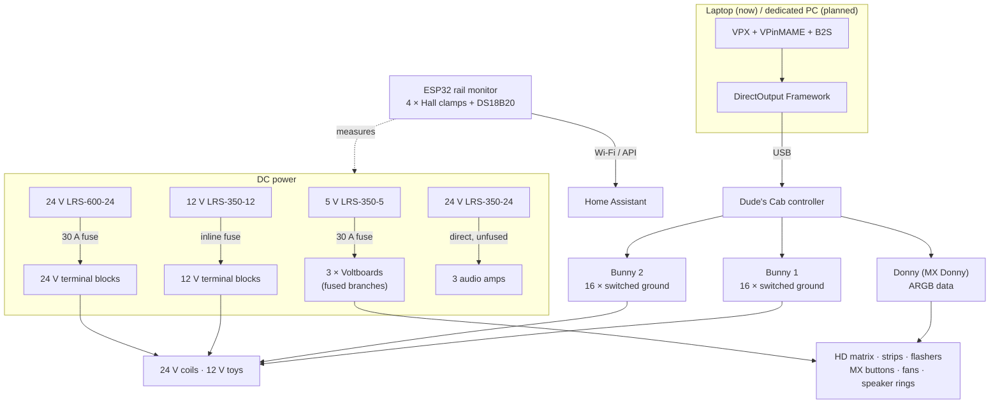

**Control principle:** every toy's **positive is always live** from its rail. The Bunny port switches the **ground** under DOF command, with PWM where a toy needs it (flipper hold, gear motor speed).

---

## 3. Power, fusing and grounding

### Power budget

| Rail | PSU (max) | Inline fuse | Main loads | Worst case / measured |
|---|---|---|---|---|
| **5 V** | LRS-350-5 (60 A) | **30 A** (was 60 A) | HD matrix, ARGB strips, flashers, fans, MX buttons | Theoretical full white is far higher (matrix alone ≈18 A), but in play the lighting is effects and flashes at set brightness levels, never sustained full white. Real gameplay draw sits **well below the 30 A ANL** |
| **12 V** | LRS-350-12 (29.2 A) | **20 A** | Bunny logic, blower, shaker, gear motor(s), beacons, bells, strobes, interior strip, button LEDs | Estimated 18-25 A at an absolute peak; realistic load well under the 20 A fuse. 25 A terminal block |
| **24 V mech** | LRS-600-24 (25 A) | 30 A | 6 bumpers, 2 slings, 2 flippers, knocker, chimes, shell bell | **≈6 A inrush per coil** (≈V/R at 24 V); **spikes of 15-30 A** measured on the rail (inrush plus switching spikes). Held flipper ≈0.1 A in a 2 % test. Estimated 12-18 A in heavy play, 20-25 A rare worst case |
| **24 V audio** | LRS-350-24 (14.6 A) | ⚠️ none | 3 amps (XY-S220H + 2 × XY-S100H) | Volume-dependent. Negative **not** bonded to the common ground (deliberate) |

### Distribution
- **5 V:** three 10 AWG from the PSU's +V terminals → **30 A ANL fuse** → 12 AWG to a 25 A terminal block → **three Voltboards**. Each Voltboard port is individually fused. ⚠️ The **last leg from the 5 V terminal block to the direct Voltboard is not separately fused**, and a 30 A ANL can't protect a lighter wire. A fuse sized to that leg is on the roadmap.
- **24 V mech:** two 12 AWG from two +V terminals → **30 A** inline fuse → 25 A terminal block(s). **12 V:** 12 AWG → **20 A** inline fuse → **25 A** terminal block. That fuse protects both the 12 AWG feed and the block. Toy wiring is 18 AWG.
- **Sizing reference:** Mean Well doesn't publish a per-terminal limit; its wire table gives 14 AWG 10-16 A, 12 AWG 16-25 A and 10 AWG 25-32 A.
- **24 V audio:** three direct runs from the dedicated PSU to the amps (no terminal block needed), with **no fuse**. Fitting a fuse per amp feed is on the roadmap. Its negative is deliberately **not bonded** to the common ground: the amps take their reference from the sound card input, which keeps fast, heavy coil return currents out of the audio ground (the usual source of hum).
- **Grounding is distributed:** a common ground block bonds the 5 V, 12 V and 24 V mech negatives, and heavy returns go back to their own PSU's -V terminals where practical. Each Bunny has two 14 AWG ground returns, split between the 24 V and 12 V supplies.

### Earthing through powder coat
The earth braid runs from the **C14 inlet** through the four legs to the coin door, and on to the lockdown bar and side rails. **Powder coat is an insulator:** continuity failed until the coating was scuffed at every bolt and plate joint (or star washers fitted). It was verified with a meter afterwards.


*5 V rail inline fuse protecting the Voltboard backhaul (photo shows the original 60 A; now 30 A).*

Detail: [01 · Architecture, power and grounding](docs/01-architecture-power-and-grounding.md) · [10 · Safety](docs/10-safety.md)

---

## 4. Control boards and I/O

| Board | Role | Key points |
|---|---|---|
| **Dude's Cab** | Main controller (USB) | Fall-off delay and value, security delay, and logic type per output |
| **Bunny 1** | 16 PWM switched-ground outputs | 1 flipper L · 2 sling L · 3 flipper R · 4 sling R · 5-7 bumpers middle L/C/R · 8 knocker · 9 shaker · 10 coin R LED · 11 repeating bell · 12 beacons · 13 topper blower · 14 coin L LED · 15 strobes · 16 start LED |
| **Bunny 2** | 16 PWM switched-ground outputs | 1 shell bell S · 2-4 chimes S/M/L · 5 shell bell L · 6-8 bumpers rear L/C/R · 9 gear motor · 10 gear motor 2 (planned) · 11-16 spare |
| **MX Donny** | ARGB data, 8 ports | **6-8: HD matrix** (paired panels). 1-5: left buttons + side + undercab strip, right equivalent, flashers, ARGB fans, speaker rings |
| **Voltboards × 3** | Fused 5 V distribution | Cab 1: left/right button + side-strip chains. Cab 2: matrix ×2, ARGB fans. Backbox: speaker rings, topper flashers, undercab L/R |
| **Brain + 4 button boards** | Inputs | Cabinet buttons and tilt on the button boards; undercab buttons and the **coin door interlock (DOOR terminal)** on the Brain |

**I/O schedule (points list):** [`data/points-list.csv`](data/points-list.csv) gives board, port, device, rail, port fuse, PTC, suppression and DOF notes for every Bunny output. Donny, Voltboard and input allocations are in [doc 02](docs/02-control-boards-and-io.md).

**Reference ground for long ARGB data runs:** run alongside the data, bonded at the **load end only**, to cut interference without creating a loop.

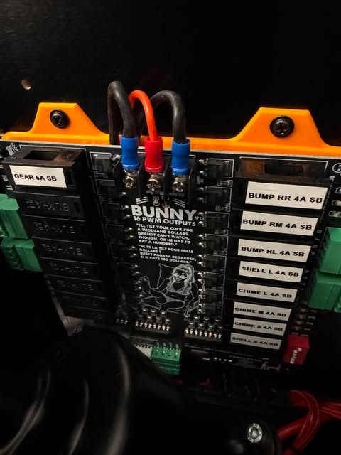
*Bunny 2 port labels (photo shows the original 4 A SB on the coils; all coils have since been changed to **2.5 A SB**).*

Detail: [02 · Control boards and I/O](docs/02-control-boards-and-io.md)

---

## 5. Lighting and the HD matrix

| Item | Detail |
|---|---|
| **HD matrix** | 6 × CSD 256-LED panels = **1,536 pixels**, configured as **96 × 16** in Dude's Cab with splits |
| Orientation | Connectors at the bottom (player view), so wires exit upward; the data snake starts bottom-left and ends bottom-right (confirmed against CSD docs) |
| Data | Three Donny ports, each feeding a **pair** of panels; frame rate kept without using six ports |
| Power | **Injection at every panel**, from two Voltboard channels (10 A slow-blow each) |
| Current | About 3 A per panel at full white (about 18 A theoretical); logos and flashing in play are far lower |
| Other ARGB | Playfield side and undercab strips (144 LED/m, about 134 LEDs each), speaker rings (2 × 128, chained inner → outer), **19 MX flashers × 4 LEDs** (5 commissioned, 14 for a custom topper), 5 MX buttons, 3 ARGB fans: **about 2,400 LEDs** in total |
| Testing white | Configurator test pulses are too short, so sustained full white used a hand-edited `directoutputconfig30.ini` with permanent `ON White` triggers |
| Strip tint | **Smoked LED strip tape** gives the tinted look; the strip covers stay clear |
| Lessons | ARGB fan connectors vary (5 V / data / GND order), so check with a meter before connecting. Cut strips sometimes need a higher LED count in the Configurator to light fully |

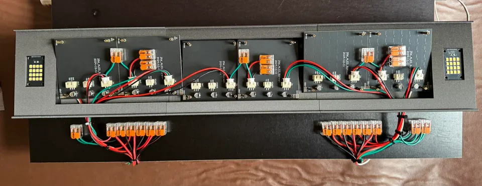
*HD matrix underside: six CSD panels with power injection and paired data chaining.*

Detail: [03 · Lighting and HD matrix](docs/03-lighting-and-hd-matrix.md)

---

## 6. Mechanical toys and coil protection

### Wiring principle
**+24 V → RUEF160 → coil → Bunny switched ground (2.5 A SB port fuse)**, with a **1N4007 across the coil, band toward +24 V**.

**Coils:** 6 pop bumpers (3 middle on Bunny 1, 3 rear on Bunny 2) + 2 slings = **8 coils**, plus **2 flippers**. All 10 have a **2.5 A slow-blow + RUEF160**. The knocker, chimes and shell bell have a 2.5 A slow-blow but **no RUEF160 yet** (decision outstanding).

### Flippers: FL-11629 (50 V coil run at 24 V) on a single Bunny port

| Lug pair | Resistance | Winding |
|---|---|---|
| Left–Middle | 122 Ω | Hold |
| **Middle–Right** | **4 Ω** | **Power** |
| Left–Right | 126 Ω | Both |

**As built:** **+24 V → right lug**, **Bunny → middle lug** (power winding only), **left lug disconnected**, with the **diode band on the right (+24 V) lug**. The diagrams show the textbook orientation (+24 V on the middle, Bunny on the right). With only the power winding in use, either polarity works, as long as the diode band sits on whichever lug carries +24 V. The factory end-of-stroke switch is normally-open and low-rated, so a classic hardware power-to-hold changeover isn't possible on one port. **Hold is done in software:**

| Dude's Cab setting | Value |
|---|---|
| Fall-off delay | 35 ms (full 24 V flip) |
| **Fall-off value** | **10 %** (the setting). In testing it still held at 2 % and dropped at 1 %; 2 % has never been used |
| Security delay | About 60 s (forces 0 % if the command sticks) |

### Bumpers and other toys
- **AE-23-800 pop bumpers:** 4.2 Ω, so ≈5.7 A at 24 V; RUEF160 on the positive leg. A stuck coil draws about 6-6.5 A and burns out in roughly 60 s.
- **Slings, Data East knocker, three-chime unit, shell bells:** +24 V to one side, Bunny to the other, diode across.
- **12 V toys:** **Stern Spike shaker kit by PinSound** (through a **7 V step-down**, kept; DOF intensity varies per table), topper blower (a 12 V **truck fan**), beacon pair (straight 12 V; no filter needed), repeating fire-alarm bell, DTG strobes, and a **VW gear motor** (the standard model recommended in the Pinscape guide) on a single PWM port, with a second one planned. DOF sets the intensity in real time, with the Configurator Max Value as the ceiling; an earlier "three ports for H/M/L" approach was superseded. Upper right covers about 80 % of gear tables; middle left is optional for the rest.
- **La Nettoyeuse** (Arnoz motor/noise filter) on **4** devices: shaker, repeating bell, topper blower and gear motor, with a 5th for gear motor 2. **None on the solenoid coils** (bumpers, slings, flippers, knocker, chimes, shell bells), which use a 1N4007 flyback only.
- **Planned bumper flash:** 470 Ω 1 W + 12 V LED, with an optional 100-220 µF, in parallel at the coil lugs *after* the PTC, so a stuck-coil trip also kills the LED.

### Protection: four layers

| Layer | Device | Covers | Evidence |
|---|---|---|---|
| 1 | Fall-off (10 %) + security delay | Normal heating; outputs left on | Hold still works down to 2 % (test), drawing only ≈0.1 A |
| 2 | **RUEF160 PTC** (all 10 playfield coils) | Stuck coil (software, USB or a VPX → Popper exit) | **Under 10 s trip, no false trips.** RUEF250 didn't trip within 15 s at 6.5 A, so it was rejected |
| 3 | Port slow-blow, **2.5 A on all coils** | Shorts, wiring faults | 2 A blew in under 0.5 s (nuisance risk); 2.5 A didn't blow in 30 s on a stuck coil, hence layer 2 |
| 4 | 1N4007 flyback | Inductive kick | A reversed diode died and blew the port fuse, which taught polarity the hard way |

**Why a PTC:** a stuck coil (6-6.5 A) burns out in about 60 s, and no slow-blow size is both quick enough on a fault and tolerant of normal pulses. The PTC trips on integrated heat (I²t), so it ignores pulses and catches sustained current. Trip speed depends on how far the fault current exceeds the trip rating:

| PTC | Ihold / Itrip | 6.5 A as a multiple of Itrip | Result |
|---|---|---|---|
| RUEF250 | 2.5 / 5.0 A | ≈1.3× | Didn't trip within 15 s (tested) ❌ |
| RUEF185 | 1.85 / 3.7 A | ≈1.75× | Fallback if nuisance trips ever appear |
| **RUEF160** | 1.6 / 3.2 A | ≈2× | **Under 10 s, no false trips (tested)** ✅ |

The CSD Coil Life Extender was evaluated and not combined with software PWM, because the two reductions compound.


*AE-23-800 bumper with an RUEF160 PTC on the positive leg.*

Detail: [04 · Mechanical toys and coil protection](docs/04-mech-toys-and-coil-protection.md) · [Diagrams: These Mortal Coils options](docs/12-diagrams.md)

---

## 7. Instrumentation: ESP32 rail monitoring

An ESPHome **ESP32-S3** measures the current on **every PSU rail** with **clamp-on DC Hall sensors**, plus one **DS18B20** temperature, and sends it to Home Assistant. Its Bluetooth proxy is also enabled.

| Per rail | Purpose |
|---|---|
| Fast raw current (20 ms) | Captures the pull-in (inrush) |
| Smoothed sustained (about 1 s) | Steady loads, e.g. a held flipper |
| Peak (inrush) tracker | Highest value since reset |
| Zero baseline / reset peak buttons | Zero and arm before a test |

`amps = (V_adc − zero_offset) / 0.02083` (20.83 mV per A), sampled on ADC1 pins at 12 dB attenuation. A 60-second history card in HA works as a live "scope" while firing toys.

### Coil current: inrush and hold

| Measurement (24 V rail clamp) | Result |
|---|---|
| Flipper inrush on firing | **≈6 A** (≈ V/R: 24 V ÷ 4 Ω) |
| Flipper hold, **test at 2 %** fall-off | **≈0.1 A**. Dude's Cab PWM scales the hold as intended (the setting is 10 %) |
| Bumper firings, smoothed | 5.5-7.2 A |
| **Spikes when coils fire** | **15-30 A** |

**About inrush:** Coils pull a large inrush at full voltage: about V/R, so **≈6 A at 24 V** for a 4 Ω winding (≈5.7 A for a 4.2 Ω bumper). That's the same surge that reaches **20 A+ on real machines running 50-70 V**. On the 24 V rail clamp, coil firings show **spikes of 15-30 A**, which also include the **electrical and magnetic switching spikes** documented when coils are pulsed and PWM'd. A shunt and oscilloscope capture will separate the two. The spikes are brief, and well within what the LRS-600-24 and the 30 A rail fuse handle. References: [doc 07](docs/07-instrumentation-esp32-and-home-assistant.md#what-inrush-means-for-a-coil).

**About the hold:** an early reading suggested the held flipper still drew ≈2 A at 2 %. Re-testing proved that wrong: the hold current is **≈0.1 A**, close to the ≈0.12 A a 2 % average of the full ≈6 A predicts. So Dude's Cab's fall-off PWM is implemented better than first assumed. The 10 % setting gives a stronger hold with a correspondingly small current.

**Next:**
- Record the hold current at the configured 10 % (≈0.6 A expected if it scales linearly).
- Shunt + oscilloscope capture of a single coil firing, to separate the pull-in from the switching spikes.
- Put the DS18B20 on a coil during a long hold.
- Add an HA "stuck output" alert: sustained rail current above a threshold.

Detail: [07 · Instrumentation and Home Assistant](docs/07-instrumentation-esp32-and-home-assistant.md) · [dashboard card](config/homeassistant/vpin-rail-current-card.yaml)

---

## 8. Audio and SSF

Three amps on the dedicated 24 V audio rail: backbox speakers plus cabinet woofer, front SSF exciters and rear SSF exciters. A USB 7.1 sound card is mapped to the standard SSF layout:

| Output | Drives | Location |
|---|---|---|
| Front (green) | Backbox L/R + woofer | Backbox |
| Surround/Side (grey) | Rear playfield exciters | Near the backglass |
| Back/Rear (black) | Front playfield exciters | Near the flippers |
| Centre/Sub | Unused | n/a |

**To verify:** flipper sounds should come from the front exciters; bumper and ball-roll sounds from the rear. If they're swapped, exchange the Surround and Back cables. Detail: [05 · Audio and SSF](docs/05-audio-and-ssf.md)

---

## 9. Software, DOF and versions

**Install order that worked:** VPinMAME → VPX (10.8 64-bit where required) → B2S Server (register the DLL) → DOF. The DOF Config Tool produces `directoutputconfig30.ini` / `90.ini`.

| Component | Version |
|---|---|
| VPX | 10.8 (64-bit) |
| VPinMAME, B2S, DOF, Dude's Cab firmware/Configurator | ⟨to record⟩ |
| ESPHome / Home Assistant | 2026.9.x / 2026.x |

**VPX and DOF as configured:**
- **DOF mapping:** the **expanded 10-output** profile. Each physical bumper takes the matching 8-bumper and 10-bumper toys (middle row: 8 Bumper L/C/R + 10 Bumper Middle L/C/R; rear row: 10 Bumper Back L/C/R, with 8 Bumper Back on rear centre). Flippers and slings map directly.
- **VPX → Keys, Nudge & DOF:** **Flippers** and **Contactors** (bumpers and slings) set to **DOF only**, so the real coils make the sound. Ball roll and other audio go to the 7.1 SSF exciters.
- **Night Mode:** turns off the real mech for quiet play. The VPX sound fallback is still to do (roadmap).
- **Bunny settings:** PWM frequency and General Power ("Masta Powaa") at **defaults**. General Power scales every Max Value and fall-off value, which matters when interpreting the hold-current test.

**Known behaviours:**
- VPX key config exposes only buttons 1-24.
- Security Delay visibility in the Configurator depends on the fall-off delay setting.
- An abrupt VPX → PinUp Popper exit can leave outputs asserted, which protection layers 1 and 2 cover.

**Coming:** a full DOF section covering every toy mapping, custom toys, hand-edited `.ini` entries and the Configurator export, with the files in [`config/dof/`](config/dof/README.md). Detail: [06 · Software, DOF and configuration](docs/06-software-dof-and-configuration.md)

---

## 10. Internal gameplay camera (planned)

**Goal:** a live view of the real bumpers and flippers inside the cabinet during play, on a **4th screen: a projector**.

| | ESP32-S3-CAM | **Raspberry Pi + Pi camera (chosen)** |
|---|---|---|
| Output | MJPEG over Wi-Fi only | **Native HDMI** to the projector |
| Frame rate | About 6 fps measured on the same board model | 50/60 fps target |
| Latency | Wi-Fi + decoder | Sensor → GPU → HDMI, no network |

**Design points:**
- Wide-angle camera module, rubber-isolated mount, full-screen preview on boot.
- **Dedicated lighting:** the interior strip is switched off by the coin-door interlock when the door is shut. Options are a small fixed-white strip, or NoIR plus IR.
- Power from a dedicated fused 5 V branch or its own supply.
- An optional low-res stream to HA.

Detail: [08 · Gameplay camera](docs/08-gameplay-camera.md)

---

## 11. Issues dealt with

| Issue | Resolution |
|---|---|
| Powder coat blocking earth continuity | Scuffed every joint; verified with a meter |
| Not enough Donny ports for the matrix | Undercab strips moved onto the playfield side-strip channels |
| Flipper EOS unusable (Fliptronics NO gold leaf: feedback only, not rated for coil current) | Power winding only on one port, with a software PWM hold set from resistance measurements |
| Flipper resistance readings ambiguous (≈0 Ω L–M, 'hold' 132 Ω) | Readings with the diodes still attached were misleading; lifted the diodes and re-measured: L–M 122 Ω, M–R 4 Ω, L–R 126 Ω |
| Slow-blow either too fast (2 A) or too slow (2.5 A) on a stuck coil | Kept 2.5 A SB for shorts and added RUEF160 PTCs for stuck coils (after RUEF250 proved too slow) |
| Undercab strips chased back-to-front against the playfield strips | Undercab data is injected from the rear; reversed with **Arrangement** in the Dude's Cab Configurator. Both now chase front to back. (The Laser test always shows the physical direction, by design) |
| 5 V direct-Voltboard leg unprotected | Identified: the 30 A ANL can't protect it; a branch fuse is on the roadmap |
| Reversed diode killed the 1N4007 and the port fuse | Replaced and polarity corrected |
| 15 A terminal blocks marginal for concurrent peaks | 25 A blocks; dual backhaul evaluated |
| 5 V inline fuse oversized for the backhaul | Reduced from 60 A to **30 A** |
| Configurator test pulses too short | Direct `.ini` permanent `ON White` |
| VPX → Popper exit leaving outputs on | Fall-off + PTC backstop |
| "Only two LEDs" on the MX button chain, blamed on a Donny port | Loose playfield strip connection had blown the MX button board; fixed and button replaced |
| Gear motor "needs three ports" | Superseded: one PWM port + DOF intensity |
| Backglass tint film impractical | Rear spray-paint blackout |

Full fault-finding notes: [09 · Troubleshooting and fault log](docs/09-troubleshooting-and-fault-log.md)

## Completed build items
Mains distribution; terminal blocks; both Bunnies and the Voltboards mounted; all mechs wired and tested; HD matrix; ARGB fans, speaker rings, strips, MX buttons and flashers; fuse labelling; flasher brackets and beacon mounts; plunger button; 12 V LED button bulbs; undercab button LEDs on the PC power-LED circuit; interior LED on the coin-door interlock; backbox screen power; earth braid; amp feeds (three direct runs; no terminal block needed).

## 12. Testing

Highlights:
- **Coils:** resistance mapping; flipper hold threshold (test: 2 % holds, 1 % drops; setting 10 %); ESP32 current profile (≈6 A inrush, ≈0.1 A held at 2 %); fuse trials (2 A SB under 0.5 s; 2.5 A SB over 30 s); **RUEF250 too slow; RUEF160 under 10 s with no false trips**.
- **Wiring:** diode polarity; chassis continuity.
- **Lighting:** sustained-white test.
- **System:** end-to-end VPX → DOF → toys on a laptop.

Full table, plus the pending tests: [test record](docs/test-record.md).

---

## 13. Roadmap

- [ ] ⚠️ **Fuse the 5 V direct-Voltboard leg** (sized to its wire), or upsize the wire.
- [ ] **Fuse the 24 V audio feeds** (one inline fuse per amp, near the PSU).
- [ ] **Decide on RUEF160s for the knocker, chimes and shell bell** (they have 2.5 A SB only).
- [ ] **Night Mode sound fallback:** Night Mode turns the real mech off, but VPX has Flippers and Contactors on DOF only, so there's no sound at all. Switch VPX to Sound/Both when Night Mode is on (e.g. a batch script with IniMod editing `VPinballX.ini`).
- [ ] Verify the order of **Donny ports 1-5** against the Configurator; add the 12 V port fuse ratings to the points list.
- [ ] **Custom topper:** 14 additional MX flashers (4 LEDs each) and mounts.
- [ ] **Gear motor 2** (Bunny 2 port 10, with La Nettoyeuse).
- [ ] **Second BST-1 bass shaker** on the spare channel of the rear-SSF amp.
- [ ] **Rail measurements:** flipper at 10 %, long-hold coil temperature, per-rail peaks during multiball, an HA stuck-output alert.
- [ ] Confirm the **ESP32 pins** (5 V clamp; DS18B20 location) and commit the live YAML.
- [ ] **DOF section:** mappings, custom toys and configs.
- [ ] Record the software and firmware **versions**.
- [ ] Bumper LED flash circuits (in parallel, after the PTC).
- [ ] **Dedicated PC + screens**, moving to PinUp Popper Baller.
- [ ] **Internal gameplay camera:** Pi + camera to the projector.
- [ ] Optional: HA table-aware lighting (MQTT from PinUp scripts + Hue colour extraction).

---

## 14. Skills demonstrated (BMS / building automation)

| Skill | Evidence |
|---|---|
| Power distribution design | Four rails, terminal-block ratings, backhaul sizing, a power budget |
| Protection coordination | Software + PTC + port fuse + diode, each layer with a defined role; fuse sized to the backhaul (60 → 30 A) |
| I/O schedule and points list | Bunny/Donny allocations with rail, fuse, PTC and settings per output |
| Field-device commissioning | Coil identification by resistance, hold-threshold testing, polarity checks |
| Instrumentation | ESP32 Hall-clamp current monitoring with inrush, sustained and peak capture |
| Measured vs expected analysis | Inrush ≈ V/R vs 15-30 A rail spikes; an early 2 A hold reading caught and corrected by re-test |
| Protection selection by test | Slow-blow trials and the RUEF250 → RUEF160 change, based on the trip-current multiple |
| Earthing and bonding | Continuity through coated metalwork |
| Systems integration | VPX → DOF → Dude's Cab → Bunny/Donny; ESPHome → Home Assistant |
| Documentation | Decision log, test record, diagrams (with Martafix), videos |

---

## Still to add to this repo

| Item | Where it will go |
|---|---|
| **All STLs used**, with links (and files where licences allow), including any that differ from the original plan | [hardware/3d-printed-parts.md](hardware/3d-printed-parts.md), `hardware/stl/` |
| **All DOF config files** (`directoutputconfig30.ini` / `90.ini`) and the Dude's Cab Configurator export | `config/dof/` |
| **Custom toys, mechanical:** DOF toy definitions, combos and settings for every real-mech device (the 10-output bumper profile, knocker, chimes, shell bells, repeating bell, gear motors, shaker, blower, beacons, strobes) | `config/dof/` + [doc 06](docs/06-software-dof-and-configuration.md) |
| **Custom toys, ARGB:** every addressable strip and segment, its LED count, Arrangement and DOF output, flashers (including the 14-flasher custom topper), MX buttons, rings, fans, undercab and side strips | `config/dof/` + [doc 03](docs/03-lighting-and-hd-matrix.md) |
| **Groups of MX / HD matrix effects:** the effect groups and combine-toy sets used on the matrix, flashers, rings and strips, with example effect strings | [doc 06](docs/06-software-dof-and-configuration.md) |
| ESP32 live YAML and confirmed pins (5 V clamp, DS18B20) | `config/esphome/` + [doc 07](docs/07-instrumentation-esp32-and-home-assistant.md) |
| Software and firmware versions | [doc 06](docs/06-software-dof-and-configuration.md) |
| Donny ports 1-5 order check; 5 V leg wire gauge; 12 V port fuse ratings | [doc 02](docs/02-control-boards-and-io.md), [points list](data/points-list.csv) |
| Notes from the YouTube videos | Folded into the relevant docs |

## Photo gallery

| | | |
|---|---|---|
| 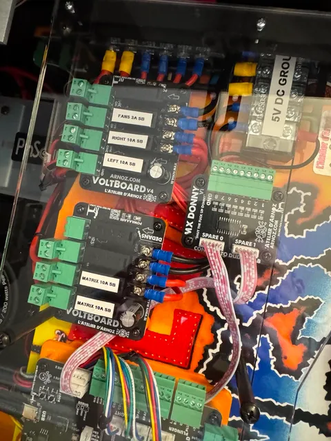<br>*Front Voltboards and MX Donny* | <br>*24 V positive terminal blocks (25 A)* | <br>*5 V PSU and ANL fuse (now 30 A)* |
| <br>*Bunny 2 port labels (coils since changed to 2.5 A SB)* | 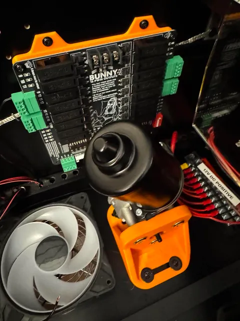<br>*VW gear motor (Bunny 2 port 9)* | <br>*AE-23-800 bumper with RUEF160* |
| <br>*HD matrix: power injection and paired data* | 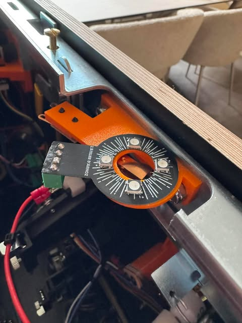<br>*MX fire button* | 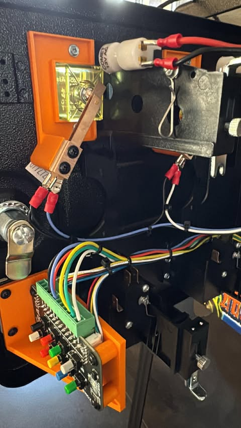<br>*Coin door interlock switch* |
| 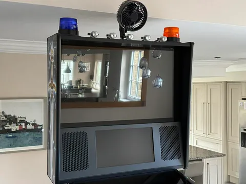<br>*Topper: beacons and blower* | <br>*La Nettoyeuse on the topper blower* | 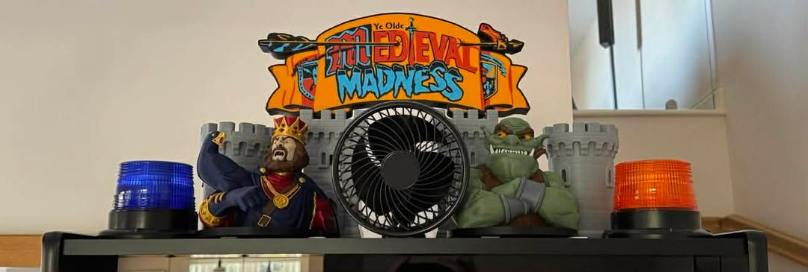<br>*Custom Medieval Madness topper* |

## Wiring diagrams

Full set with descriptions: [doc 12 · Diagrams](docs/12-diagrams.md). Click a preview to open the PDF.

| | | |
|---|---|---|
| [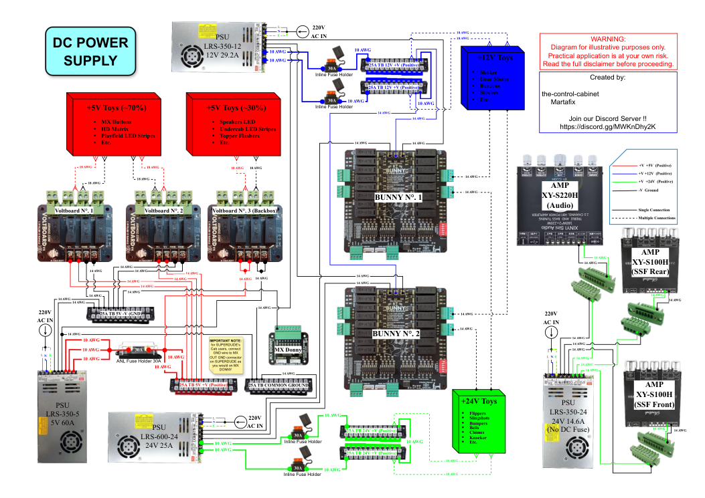](diagrams/dc-power-supply-v1.6.pdf)<br>*DC power supply v1.6* | [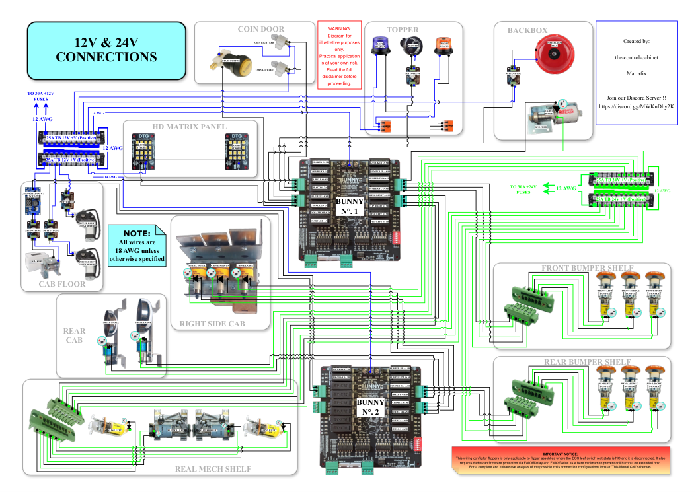](diagrams/12v-24v-toys-single-green-connector-version-v1.5.pdf)<br>*12 V / 24 V toys v1.5* | [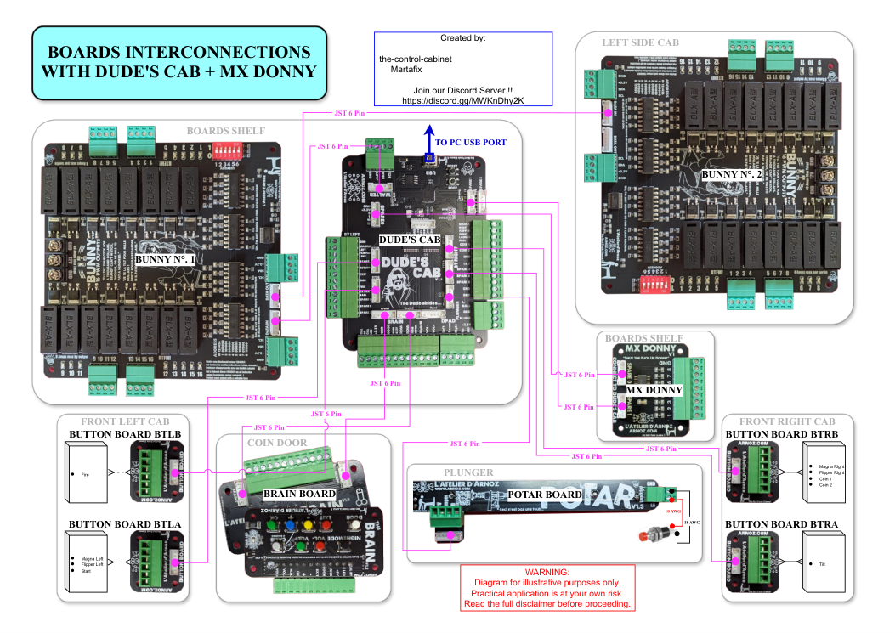](diagrams/boards-interconnections-dudes-cab-plus-mx-donny-version-v1.2.pdf)<br>*Board interconnections v1.2* |
| [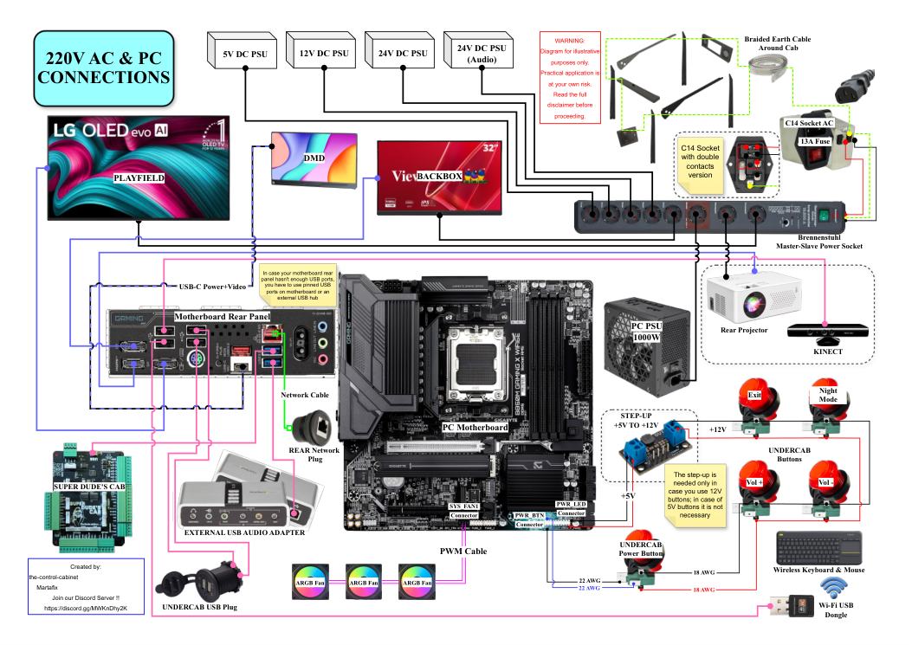](diagrams/220v-ac-and-pc-connections-v1.1.pdf)<br>*230 V AC and PC v1.1* | [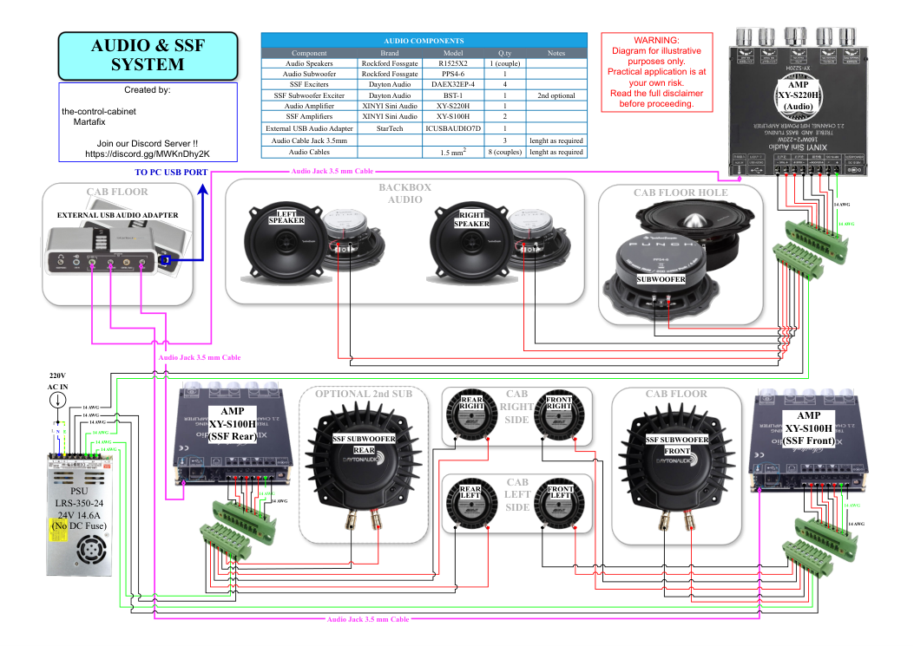](diagrams/audio-and-ssf-system-v1.2.pdf)<br>*Audio and SSF v1.2* | [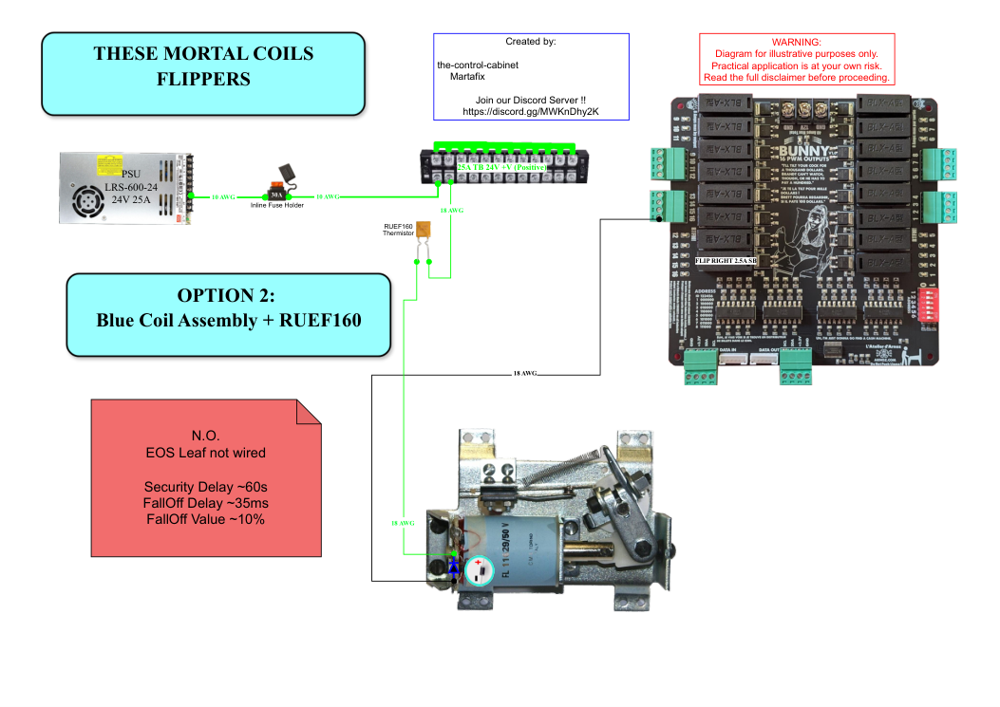](diagrams/this-mortal-coil-flipper-option-2-v1.1.pdf)<br>*These Mortal Coils: flipper option 2* |

## 15. Videos

**[The Control Cabinet on YouTube](https://www.youtube.com/channel/UC5Cupmz7vlfcodpCX7k8iuQ)**:

- [Mortal Coils! How I protect the Real-Mech Coils](https://www.youtube.com/watch?v=ZbsF-g5vIfU)
- [Protecting Real Mech flipper coils with hardware](https://www.youtube.com/watch?v=URfTXkrg76k)
- [Why I installed in-line DC fuses](https://www.youtube.com/watch?v=xdAt1k0HEi0)
- [Configuring Dudescab Bunny boards for Real Mech](https://www.youtube.com/watch?v=xSo2La5fzV8)
- [Arnoz MX Buttons](https://www.youtube.com/watch?v=NzLpOJl-FJ4)
- Cabinet tour: [Part 1](https://www.youtube.com/watch?v=klSNuN602sY) · [Part 2](https://www.youtube.com/watch?v=AOLksZjaci8) · [Part 3](https://www.youtube.com/watch?v=pzLITTsYfg4)
- [Medieval Madness topper](https://www.youtube.com/watch?v=NNeiCwCUsZ4)
- [Real-Mech add-on install, Part 5](https://www.youtube.com/watch?v=k3RY8v4qDzQ)

What each video contributed: [11 · Videos](docs/11-videos.md)

---

## 16. Documents, diagrams and repository map

| Doc | Covers |
|---|---|
| [01 Architecture, power and grounding](docs/01-architecture-power-and-grounding.md) | Topology, power budget, PSUs, blocks, fuses, Voltboards, earthing |
| [02 Control boards and I/O](docs/02-control-boards-and-io.md) | Bunny and Donny allocations, matrix splits, reference ground |
| [03 Lighting and HD matrix](docs/03-lighting-and-hd-matrix.md) | CSD panels, data snake, injection, LED counts |
| [04 Mechanical toys and coil protection](docs/04-mech-toys-and-coil-protection.md) | Flippers, bumpers, gear motors, La Nettoyeuse, protection options |
| [05 Audio and SSF](docs/05-audio-and-ssf.md) | Amps and 7.1 SSF mapping |
| [06 Software, DOF and configuration](docs/06-software-dof-and-configuration.md) | Versions, install order, Configurator behaviour, DOF tests |
| [07 Instrumentation and Home Assistant](docs/07-instrumentation-esp32-and-home-assistant.md) | ESP32 rail monitor, YAML, dashboard, hold test, HA/Hue design |
| [08 Gameplay camera](docs/08-gameplay-camera.md) | Pi-based camera to the projector |
| [09 Troubleshooting and fault log](docs/09-troubleshooting-and-fault-log.md) | Symptoms and fixes; MX button fault |
| [10 Safety](docs/10-safety.md) | Mains, fusing principles, coil protection, polarity, thermal |
| [11 Videos](docs/11-videos.md) | Channel videos and what they contributed |
| [12 Diagrams](docs/12-diagrams.md) | All wiring diagrams with previews |
| [Decision log](docs/decision-log.md) · [Test record](docs/test-record.md) | Locked choices; test results |
| [Parts list](hardware/parts-list.md) ([xlsx](hardware/parts-list.xlsx)) | Every part, with link, notes and installed/planned status |
| [3D printed parts](hardware/3d-printed-parts.md) | STLs used, with source links |

```
.
├── README.md · CHANGELOG.md · LICENSE
├── config/
│   ├── dof/            ← DOF .ini + Configurator export (to come)
│   ├── esphome/        ← rail-monitor YAML (to come)
│   └── homeassistant/  ← rail current dashboard card
├── data/points-list.csv            ← I/O schedule (draft)
├── diagrams/*.pdf + previews/*.png ← wiring diagrams (kebab-case names)
├── docs/                           ← 01-12, decision log, test record
├── hardware/parts-list.xlsx · .md  ← full parts list (installed / planned)
├── hardware/3d-printed-parts.md    ← STLs used, with links
└── images/                         ← build photos
```

**Disclaimer:** one specific cabinet. Every value is as measured or calculated here, so verify before copying. Incorrect coil or power wiring can damage parts or cause a fire. MIT Licence.

*Built and documented by James · diagrams co-authored with Martafix · part of [The Control Cabinet portfolio](https://github.com/the-control-cabinet).*
