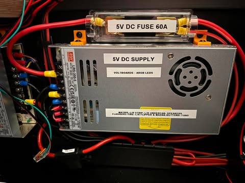
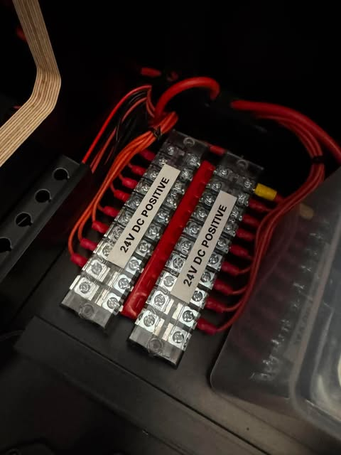

# 01 · Architecture, Power and Grounding

[← Back to README](../README.md)

## Power budget

| Rail | PSU | PSU max | Inline fuse | Main loads | Worst-case notes | Measured (ESP32 clamp) |
|---|---|---|---|---|---|---|
| 5 V | LRS-350-5 | 60 A | 30 A | HD matrix (6 × 256 LEDs), ARGB strips, flashers, fans, MX buttons | Theoretical full white: matrix ≈18 A (≈3 A per panel) and ≈50-60 mA per ARGB LED. In play, effects, flashes and brightness settings keep the real draw **well below the 30 A ANL**; sustained full white never happens in a game | ⟨to record⟩ |
| 12 V | LRS-350-12 | 29.2 A | **20 A** | Bunny logic, blower, shaker, gear motor(s), beacons, bells, strobes, interior strip, button LEDs | Estimated 18-25 A absolute peak; realistic load well under 20 A. 25 A terminal block | ⟨to record⟩ |
| 24 V mech | LRS-600-24 | 25 A | 30 A | Pops, slings, flippers, knocker, chimes, shell bells | Each coil ≈6 A inrush (≈ V/R). Estimated 12-18 A in heavy play, 20-25 A rare worst case. Held flipper ≈0.1 A (2 % test) | Inrush ≈6 A per coil; 15-30 A spikes on the rail (inrush plus switching spikes); hold ≈0.1 A (2 % test) |
| 24 V audio | LRS-350-24 | 14.6 A | none | 3 amps (XY-S220H + 2 × XY-S100H) | Depends on volume; negative isolated from the common ground (deliberate) | ⟨to record⟩ |

The ESP32 rail clamps ([doc 07](07-instrumentation-esp32-and-home-assistant.md)) are the tool for completing the measured column: reset the peak, play a busy multiball table, read the peak and sustained values per rail.

---

## Hardware Architecture

### High-level overview
The cabinet uses a hybrid control architecture:

- **Dude’s Cab** main controller (USB-connected) driving:
  - **Bunny boards** — switched ground for 24 V mechanical toys and some 12 V devices
  - **Donny boards** — ARGB data for LED strips, flashers, matrix sections, fans, etc.
- **Voltboards** — 5 V power distribution and fusing for ARGB loads
- Multiple Mean Well LRS series PSUs (5 V, 12 V, 24 V mech, 24 V audio)
- Common ground system tying the PSUs together

### Major subsystems
| Subsystem | Primary control | Voltage | Notes |
|-----------|-----------------|---------|-------|
| Mechanical toys (pops, slings, flippers, knocker, etc.) | Bunny (ground switch) | 24 V | Positive always live; Bunny switches ground |
| ARGB lighting (matrix, strips, flashers) | Donny (data) + Voltboards (power) | 5 V | Data from Donny; power injected via Voltboards |
| Cabinet fans (PWM) | Bunny or motherboard | 12 V | Originally Bunny; later moved toward motherboard PWM |
| Audio amps | Direct from 24 V audio PSU | 24 V | No intermediate terminal block / inline fuse in final layout |
| HD matrix | Donny (3 ports) + Voltboards | 5 V | 6 × 256-LED CSD panels, data chained in pairs |
| Service / button LEDs | Mixed | 12 V / 5 V | Some on Bunny, some on other circuits |

### Data path
- Laptop / future PC → USB → Dude’s Cab
- Dude’s Cab → Bunny boards (JST / serial style control)
- Dude’s Cab → Donny boards (ARGB data)
- DOF (via VPX) generates the toy and lighting commands that Dude’s Cab executes

### Physical layout notes
- Backbox contains speaker rings, topper-related lighting, and backbox Voltboard.
- Main cabinet houses Bunny boards, Donny boards, terminal blocks, and most power distribution.
- HD matrix sits at the top of the playfield / base of the backbox.
- Cable management uses tracks/trays; major runs are labelled.

See individual subsystem documents for wiring detail, current calculations, and allocation tables.

---

## Power Distribution — As Built

Source: DC Power Supply diagram v1.6 and 12V & 24V Connections diagram.

*5 V rail inline fuse protecting the backhaul (photo shows the original 60 A fuse; now **30 A**).*

### PSUs
| Rail | Model | Rating | Notes |
|------|-------|--------|-------|
| 5 V | LRS-350-5 | 60 A | ARGB (Voltboards, matrix, strips, fans). **30 A** inline fuse (was 60 A). |
| 12 V | LRS-350-12 | 29.2 A | Toys, beacons, topper blower, interior LEDs, shaker (via 7 V step-down), etc. **20 A** inline fuse. |
| 24 V mech | LRS-600-24 | 25 A | Coils, gear motor, chimes, shell bells. Inline fuse. |
| 24 V audio | LRS-350-24 | 14.6 A | Three amps (XY-S220H audio + two XY-S100H SSF). No DC fuse (see the [safety](10-safety.md) notes). |

### PSU terminal strategy (from the power and wiring design)
Mean Well doesn't publish a per-terminal current limit for the LRS series. Its wire table is the guide: 14 AWG 10-16 A, 12 AWG 16-25 A, 10 AWG 25-32 A. The three +V and three -V screw terminals are paralleled internally, so load is spread across them.

| PSU | Positive | Negative |
|---|---|---|
| LRS-600-24 (mech) | Two 12 AWG from two +V terminals → 30 A fuse → 25 A terminal block (third terminal jumper optional) | Bunny ground returns distributed across the -V terminals |
| LRS-350-5 | Three 10 AWG (one per +V terminal) → 30 A ANL → 12 AWG to the 25 A terminal block; branches to the Voltboards | One -V to the common bond; two -V for returns |
| LRS-350-12 | 12 AWG → 20 A fuse → 25 A terminal block | 12/14 AWG return |
| LRS-350-24 (audio) | Three direct runs to the amps | Isolated from the common ground |

Runs are short (about 0.75 m), so voltage drop is low. On 5 V, aim to keep the drop under about 0.2-0.3 V at the farthest point. **Check for heat** at the 25 A blocks, fuses and terminals after heavy play, especially the 5 V block under full-white tests.

## Terminal blocks and feeds
- 12 V and 24 V positive: upgraded dual terminal blocks (25 A class), labelled.
- 5 V: terminal block feeding three Voltboards.
- Common ground block tying the rails.
- Backhauls: 10 AWG and 12 AWG on the heavy positive runs; most toy wiring 18 AWG.

### Inline fuses (positive side)
- 5 V: **30 A ANL** (reduced from the original 60 A). It protects the heavy backhaul; the Voltboard port fuses protect the LED branches. ⚠️ The **last leg from the 5 V terminal block to the direct Voltboard is not separately fused**. A 30 A ANL can't protect a lighter wire, so a fuse sized to that leg (or a heavier wire) is on the roadmap.
- 24 V mech: 30 A inline (per the DC Power Supply diagram v1.6).
- 12 V: **20 A**. That's correctly below both the 12 AWG feed (about 16-25 A) and the 25 A terminal block.
- 24 V audio: **none**. Single direct runs from the PSU screw terminals to the three amps, with no terminal block. Fusing was skipped to save the hassle of wiring holders into short single runs. Fitting a fuse per amp feed is on the [roadmap](../README.md#13-roadmap).

### Bunny boards
Two Bunny boards (16 PWM outputs each).  
Bunny 1 and Bunny 2 share the 12 V and 24 V rails. Each has dual ground returns.

### Voltboards
Three Voltboards for 5 V ARGB distribution:
- Voltboard 1 & 2: front (matrix, playfield strips, fans, MX buttons).
- Voltboard 3: backbox (flashers, undercab strips, speaker rings).

### Physical confirmation

*Two 25 A-class terminal blocks labelled “24V DC POSITIVE”, fed from the LRS-600-24 with 10/12 AWG backhauls.*

*LRS-350-5 inline fuse feeding the Voltboards (original 60 A shown; now 30 A).*

See also the full [DC Power Supply diagram v1.6](../diagrams/dc-power-supply-v1.6.pdf).

---

## Voltboards

Voltboards provide fused 5 V distribution for ARGB loads. They sit between the 5 V PSU (via terminal block / fuse) and the LED strips / matrix / flashers.

### Role
- Multiple output ports, each fused.
- Power injection points for long LED runs and the HD matrix.
- Separate from Donny (which only carries data).

### Typical split
- One Voltboard: flashers + undercab strips + speaker rings.
- Two Voltboards (via terminal block): HD matrix + playfield edge strips + MX buttons + ARGB fans.

### Current considerations
- Each CSD panel ~3 A max at full white.
- Six panels can theoretically approach 18 A if all fully lit (rare in practice).
- Strips (144 LED/m style) ~50–60 mA per LED at full white.
- Terminal block between PSU and the two matrix-related Voltboards must be rated for the combined load.
- Parallel backhaul wires can be added if needed.

### Fusing
Voltboard ports have their own fuses. The upstream inline fuse (30 A, originally 60 A) is primarily for short-circuit protection of the backhaul, not for normal LED load limiting.

---

## Grounding and Bonding

### Common ground approach

**Strategy: distributed.** The common block bonds the PSU negatives (one heavy wire per PSU is enough, since each PSU's -V terminals are internally connected). Heavy returns go as directly as practical to their own PSU. Each Bunny's two 14 AWG grounds are split: one to the 24 V PSU, one to the 12 V PSU. A central heavy ground bus remains a possible later upgrade.

**The 24 V audio PSU is deliberately left isolated.** The amps reference to the sound card's audio ground, which keeps fast, heavy coil return currents out of the audio path.

A dedicated common ground block is used. Each PSU negative is connected to this block (typically one connection per PSU). Circuit returns preferably go back to their own PSU negative, with the common block providing the equipotential bond.

### Cabinet chassis grounding
- Grounding braid starts at the C14 inlet terminal.
- Routes via the four cabinet legs to the coin door.
- Side rails are intended to be grounded via the lockdown bar and coin door.
- Powder coating on legs, coin door, and lockdown bar required scuffing at contact points to achieve continuity.
- Testing showed initial lack of ground continuity until coating was removed at bolt/plate interfaces.

### Bunny board grounds
Each Bunny has two ground terminals (both for full ground return of switched loads). These are returned via 14 AWG (or thicker) to the appropriate PSU negative or common ground. Dual grounds on the Bunny exist to share concurrent current from multiple toys.

### Notes from build
- Powder coating is an insulator. Scuffing or star washers at mechanical joints is required for reliable chassis ground.
- For a fault (loose live wire inside cabinet), the external powder-coated surfaces still need a low-impedance path back to the inlet ground via the braid and scuffed joints.
- Separate circuit grounds (5 V, 12 V, 24 V) are bonded at the common block but return currents should preferably stay local to their PSU where possible.

### Recommendations retained
- Verify continuity from each major metal part (legs, coin door, lockdown bar, side rails) back to the C14 ground after final assembly.
- Keep Bunny aggregate grounds sized for peak concurrent toy current.

---

## Wiring conventions

| Item | Convention |
|---|---|
| 24 V mech | 18 AWG **red** for +24 V to each coil; 18 AWG **black** from the coil to its Bunny port; 1N4007 on every coil, band to +24 V |
| Backhauls | 10 AWG (5 V PSU → ANL), 12 AWG (rail feeds), 14 AWG (Bunny grounds) |
| ARGB | Power star from the Voltboards; data series; long data runs twisted with a reference ground bonded at the LED end only |
| Audio | Speaker cable away from data and coil wiring; 90° crossings |
| Labelling | Printed labels under clear heat shrink on every wire end |

