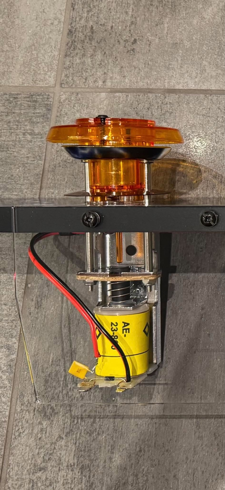
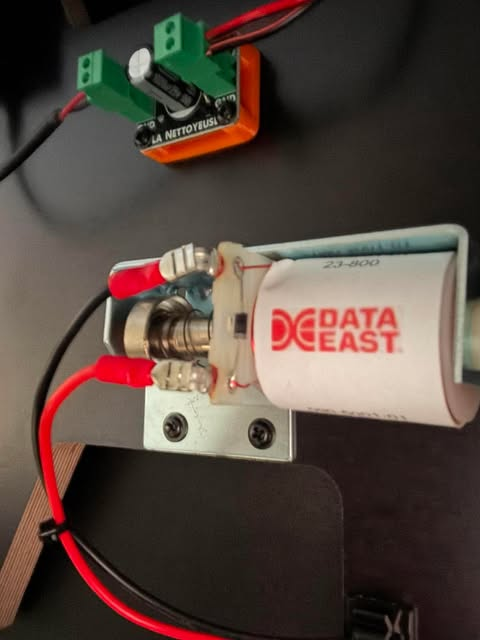

# 04 · Mechanical Toys and Coil Protection

[← Back to README](../README.md)

---

## Playfield Toys, Coils, and Protection Details

### Pop bumpers (AE-23-800)
- Coil: Williams AE-23-800 style.  
- Positive path: 24 V terminal block → RUEF160 PTC → coil positive pin.  
- Return: coil negative pin → Bunny port.  
- Diode: 1N4007 across the two coil pins, white band toward positive.  
- Observed: reverse diode polarity immediately destroys the diode and blows the Bunny port fuse (even a 4 A fuse). Correct polarity + new diode restores operation.  
- Lamp sockets: standard Williams-style pop bumper lamp sockets with 12″ insulated stranded leads (equivalent to Williams 24-8776 / Stern 077-5206-00). Assemblies used have no dedicated molded socket pocket; the socket sits free-floating inside the bumper body with a centering ring.  
- Coil: 4.2 Ω, so ≈5.7 A inrush at 24 V (≈ V/R). On the 24 V rail clamp, firings produced smoothed readings of 5.5-7.2 A and **spikes of 15-30 A**, which include the electrical and magnetic switching spikes documented when coils are pulsed and PWM'd (see [07](07-instrumentation-esp32-and-home-assistant.md#what-inrush-means-for-a-coil)).
- Planned local LED flash (no new long wire runs): at the coil lugs (after the PTC) hang a 470 Ω 1 W resistor in series with a 12 V car LED, plus an optional 100–220 µF 25 V electrolytic across the LED. The capacitor stretches the visible flash to roughly 80–150 ms after the Bunny port opens. Because the PTC is upstream, a stuck-coil trip removes power from both the coil and the LED leg.

### Flippers (FL-11629 / 50 V run at 24 V)
Three-lug coil. Resistance measured with all diodes lifted and meter zeroed:  
- Left–Middle: 122 Ω  
- Middle–Right: 4 Ω  
- Left–Right: 126 Ω  

The middle lug is the junction between the two windings: **power winding M–R (≈4 Ω)**, **hold winding L–M (≈122 Ω)**.

**As-built single-Bunny wiring (power winding only):**
- **+24 V → right lug**
- **Bunny switched ground → middle lug**
- **Left lug (hold winding) disconnected**
- 1N4007 across middle–right, **white band on the right (+24 V) lug**
- 2.5 A slow-blow port fuse + RUEF160 on the positive leg

The diagrams show the textbook orientation (+24 V on the middle lug, Bunny on the right). With only the power winding in circuit, **coil polarity doesn't matter**; what matters is that the diode band sits on whichever lug carries +24 V. A reversed diode is a dead short when the Bunny switches on.

**Measurement lesson:** early readings taken with the diodes still fitted were misleading. They showed ≈0 Ω L–M (through a diode), and a "hold" of about 132 Ω. Lifting the diodes gave the true values above.

**Hold is done in software:** Dude's Cab fall-off PWMs the power winding after the initial full-voltage kick.

| Setting | Value | Note |
|---|---|---|
| Fall-off delay | 35 ms | Full 24 V kick for the flip |
| **Fall-off value** | **10 %** | **The setting** |
| Lowest value that still holds (test only) | 2 % | Held after the full pull-in; dropped at 1 %. Never used as the setting |
| Security delay | about 60 s | Forces 0 % if the command stays asserted |

**Measured (ESP32 Hall clamp, 24 V mech rail) during the 2 % test:** ≈6 A inrush, then **≈0.1 A** while held. Dude's Cab's fall-off PWM scales the hold current as intended. An earlier ≈2 A reading was proven wrong by re-test. See [07 · Instrumentation](07-instrumentation-esp32-and-home-assistant.md#the-flipper-hold-test).

The factory EOS leaf on this assembly is normally-open and low-current-rated, so it was removed and is not used for power/hold transition. (C-9952-style assemblies with a normally-closed high-rated EOS would allow true electrical power/hold switching on a single Bunny port; that route was not taken.)

### Other 24 V toys
Slingshots, Data East knocker, three-chime unit, shell bells: standard +24 V to one side, Bunny ground to the other, 1N4007 across the coil (band to positive).  

### 12 V toys on Bunny
**Stern Spike shaker kit by PinSound** (fed through a **7 V step-down**, kept; DOF varies the intensity per table), topper blower (a 12 V **truck fan**), beacon pair (shared port), fire-alarm bell, DTG strobes, VW gear motor (191955113A / 191955119AX family). The **topper blower** has a genuine **Arnoz La Nettoyeuse** fitted. Gear motor uses a La Nettoyeuse or equivalent (1N4007 + 1000 µF electrolytic across the motor terminals).

### Protection summary retained from build
- Software: FallOff Value = 0 and short FallOff Delay on pure pulse devices (bumpers). Security Delay appears or disappears in the Dude’s Cab UI depending on the fall-off delay setting.  
- Hardware: 2.5 A slow-blow port fuse on every coil, plus an RUEF160 on the positive leg of all 10 playfield coils (6 bumpers, 2 slings, 2 flippers). The knocker, chimes and shell bell have no RUEF160 yet (decision outstanding).  
- A stuck AE-23-800 draws ~6 A. A 2.5 A slow-blow does not open instantly; the PTC is the device that limits prolonged faults.  
- Abrupt VPX → PinUp Popper exits can leave DOF outputs asserted; Dude’s Cab fall-off behaviour is the mitigation where configured.

---

## Flipper Coils — FL-11629

### Identification
- Power winding (low resistance): ~4 Ω between middle and right lugs.
- Hold winding (high resistance): ~122 Ω between left and middle.
- Total L–R ≈ 126 Ω.

### Final wiring (single Bunny port)
- +24 V to the **right** lug; Bunny switched ground to the **middle** lug; **left lug disconnected** (hold winding unused).
- 1N4007 across middle–right, white band on the **right** (+24 V) lug.
- PWM fall-off in Dude's Cab provides the hold: **10 %** (tested down to 2 %).

### End-of-stroke switch: why it isn't used
| Era | EOS at rest | Role |
|---|---|---|
| Pre-Fliptronics | Normally closed, high-current tungsten | Physically switches the power winding off at the top of the stroke |
| **Fliptronics (this assembly)** | **Normally open, gold, low-current** | Feedback to the CPU only; **not rated for coil current** |

A true hardware power-then-hold would need a second Bunny port or a replacement NC tungsten EOS. The software PWM hold on one port was chosen instead.

### Why this arrangement
- Assembly EOS is NO and low-rated; cannot be used for reliable power/hold switching without additional relay.
- Single Bunny port constraint.
- 24 V supply (coil originally 50 V); PWM provides the reduced average voltage for hold.

### Measurement procedure
Lift diode legs, zero meter, measure all three pairs both ways. Confirm middle is the low-resistance junction before soldering.

---

## Pop Bumpers

### Coil
AE-23-800 style.  
+24 V → RUEF160 → coil positive pin.  
Other pin → Bunny ground.  
1N4007 across pins, band toward positive.

### Lamp socket
Standard Williams pop bumper lamp socket with 12" insulated stranded leads (Stern 077-5206-00 / Williams 24-8776 equivalent).  
No dedicated molded fitting on the assemblies used; socket sits free-floating inside the bumper body with a centering ring.

### Planned LED flash (no new long wires)
Parallel at the coil lugs (after the PTC):
- 470 Ω 1 W series resistor
- 12 V car LED
- Optional 100–220 µF 25 V electrolytic across the LED for ~80–150 ms visible flash

When the Bunny port closes the LED lights. Capacitor stretches the flash slightly after the port opens.  
Stuck-coil case: RUEF160 trips and removes power from both coil and LED leg.

---

## Coil Protection — Options, Measurements, and Final Layered Strategy

Source: *Mortal Coils!* video and bench testing. Coils are Williams-style, about 4 Ω (AE-23-800 4.2 Ω), so ≈5.7-6 A at 24 V. A stuck coil measured about 6-6.5 A and **burns out in roughly 60 s**.

### Fuse and PTC trials

| Test (stuck coil, ≈6-6.5 A) | Result | Verdict |
|---|---|---|
| 2 A slow-blow | Blew in **under 0.5 s** | Too fast: nuisance risk on normal pulses |
| 2.5 A slow-blow | **Didn't blow within 30 s** | Too slow for a stuck coil; kept for shorts |
| RUEF250 PTC (2.5 / 5.0 A) | **Didn't trip within 15 s** at 6.5 A (only ≈1.3× Itrip) | Rejected |
| RUEF185 (1.85 / 3.7 A) | ≈1.75× Itrip | Fallback if nuisance trips ever appear |
| **RUEF160 (1.6 / 3.2 A)** | ≈2× Itrip: **trips in under 10 s; no false trips in play** | **Chosen**, on all 10 playfield coils |

Why it works: PTCs respond to accumulated heat (I²t), not peak current, so short pulses don't trip them, but a sustained fault does. Trip time shortens as the fault current rises above Itrip, and is affected by ambient temperature, mounting and airflow. After tripping it stays high-resistance until power is removed and it cools.

*RUEF160 PTC fitted on the positive leg of an AE-23-800 bumper coil.*

### Software (Dude’s Cab Configurator) — primary layer
- Pulse toys (bumpers, slings, knocker, chimes, shell bells): Fall-off delay 35 ms, Fall-off Value 0 %. Coil de-energises after the brief fire.
- Flippers: Fall-off delay 35 ms, **Fall-off Value 10 %** (still held at 2 % in testing), plus Security Delay (about 60 s) that forces 0 % if the command remains asserted.
- Pros: Free, integrated, accepted community practice.
- Cons: Can fail on software bugs, abrupt VPX→PinUp Popper exit, or user misconfiguration. Hardware backstop required.

### Hardware options evaluated
| Option | Role | Behaviour on stuck 6.5–7 A coil | Pros | Cons |
|--------|------|----------------------------------|------|------|
| Bunny port slow-blow fuse (2.5 A or 4 A) | Short-circuit protection | Does **not** open within 60 s | Cheap, protects wiring | Inadequate for sustained stuck-coil current |
| Free-wheeling diode (1N4007) | Flyback suppression | No effect on stuck current | Essential for Bunny survival | Not coil protection |
| Inline feeder fuse (20–30 A) | Backhaul short protection | No effect on single-coil stuck current | Protects thick feed wires | Irrelevant to stuck-coil scenario |
| RUEF160 PTC (on positive leg) | Sustained over-current | **Tested: trips in under 10 s on a stuck coil, with no false trips in normal play**; goes high-resistance, removes power; resets when cool | Cheap (~30–40 ¢), resettable, no software dependency | Fixed trip time, no fine adjustment |
| CSD Coil Life Extender | Voltage regulation after delay | DIP-switch delay + pot for fall-off voltage | Adjustable hardware equivalent of software fall-off | Costly; conflicts with Dude’s Cab PWM hold (compound reduction); more wiring |

### Final layered strategy used
1. Software fall-off + security delay (primary).
2. RUEF160 PTC on the positive leg of high-current coils (hardware backstop that trips even if software fails).
3. Bunny port slow-blow fuse (short protection).
4. Free-wheeling diode (flyback).

CSD boards were evaluated but not used in combination with software PWM hold because the two voltage reductions compound. PTCs were fitted on bumpers and flippers.

See also: [Bunny boards](02-control-boards-and-io.md), [Flipper coils](04-mech-toys-and-coil-protection.md).

### As-built examples

*AE-23-800 bumper coil with RUEF160 PTC on the positive leg (Option 2 style).*

Detailed options: see Flipper Option 1–6 and Bumper-Sling Option 1–3 PDFs in `diagrams/`.

---

## Gear Motors — Location, Intensity Control, and DOF

### Intensity control (corrected / final)
Dude’s Cab + Bunny ports are true PWM.  
- Configurator **Max Value** (0–255) sets the ceiling for that port.  
- DOF intensity values (0–48 scale or equivalent) are applied in real time within that ceiling.  
- **One Bunny port per physical motor is sufficient** for variable intensity.  
- Multiple parallel ports are only required if you want hard-coded fixed levels that ignore DOF intensity.  

This matches shaker behaviour. Earlier advice in one thread that three ports were required for H/M/L was incorrect and has been superseded.

Practical setup:
- Assign the port to the Gear toy in the DOF Config Tool.
- Set Max Value (and optionally General Power) in Dude’s Cab Configurator to the desired maximum strength.
- Leave Digital mode off.
- Intensity can come from Config Tool gear intensity settings or from `Ixx` parameters where present in table configs.

### Location recommendations (from review of ~272 tables that use the Gear toy)
Binary simplification used for planning:

| Location | Approx. share | Notes |
|----------|---------------|-------|
| Upper Right (UR) | ~78–81 % | Dominant (elevators, cranes, Thing, most right-side mechanisms) |
| Middle Left (ML) | ~19–22 % | Minority (e.g. Medieval Madness castle) |

**Practical default:** One motor at Upper Right covers the large majority.  
A second motor at Middle Left improves the remainder.  

Examples:
- Addams Family → UR (Thing + bookcase)
- Medieval Madness → ML (castle)
- Monster Bash, Jurassic Park, AFM, Ghostbusters, most others → UR
- Funhouse → ML

Additional motors (top-left ~6–9 %, front ~3–6 %) have low ROI for most users.

### Pitch
Medium pitch covers ~85–90 % of tables. Low and High are minorities. Pitch was de-prioritised relative to location.

### Hardware notes
Standard VW gear motor (the model recommended in the Pinscape build guide), 12 V, on Bunny 2 port 9 with a **La Nettoyeuse**. Gear motor 2 is planned on Bunny 2 port 10.

See also: [La Nettoyeuse](04-mech-toys-and-coil-protection.md#la-nettoyeuse), [Bunny boards](02-control-boards-and-io.md).

---

## La Nettoyeuse

Arnoz La Nettoyeuse is a noise filter for **motor and bell** loads on Bunny outputs.

**Where it's used (4 fitted, 1 planned):**
- Shaker (Stern Spike kit by PinSound, Bunny 1 port 9)
- Repeating fire-alarm bell (Bunny 1 port 11)
- Topper blower, a 12 V truck fan (Bunny 1 port 13)
- Gear motor (Bunny 2 port 9), plus gear motor 2 when fitted (port 10)

**Not used on the solenoid coils** (bumpers, slings, flippers, knocker, chimes, shell bells). They use a 1N4007 flyback diode only. **Beacons** need neither.

*La Nettoyeuse fitted to the topper blower motor.*
