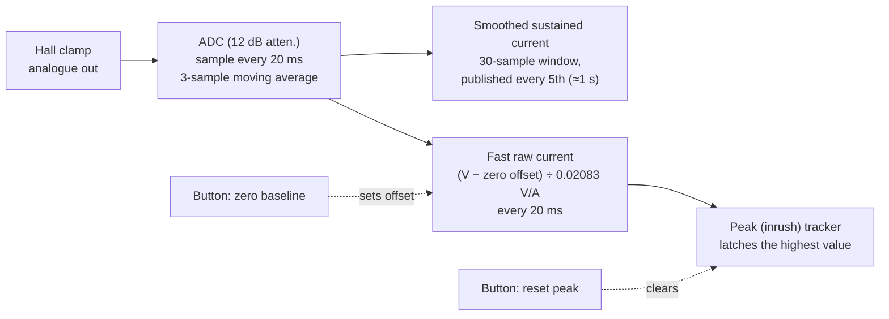

# 07 · Instrumentation: ESP32 Rail Monitoring and Home Assistant

[← Back to README](../README.md)

The cabinet has its own instrumentation layer. An ESP32 running ESPHome measures the current on **every PSU rail** with clamp-on DC Hall sensors, plus a temperature, and sends it all to Home Assistant. It turns the protection design (fall-off values, PTCs, fuses) from "configured" into **measured**.

## Hardware

| Item | Detail |
|---|---|
| Controller | ESP32-S3 (quad PSRAM), ESPHome, ESP-IDF framework |
| ESPHome device | `esp-vpin-sensor`, friendly name **ESP32 Virtual Pinball** |
| Current sensors | **4 × clamp-on DC Hall current sensors** (30 A class), one per PSU output: 5 V, 12 V, 24 V mech, 24 V audio |
| Temperature | **1 × DS18B20** on a one-wire bus |
| Extras | Bluetooth proxy enabled (spare capacity, extra BLE coverage for that room) |
| Credentials | API encryption key, Wi-Fi and fallback hotspot via `!secret` |

### Pin allocation

| Signal | GPIO | Status |
|---|---|---|
| 12 V rail clamp | GPIO4 (ADC1) | Confirmed in config |
| 24 V audio rail clamp | GPIO1 (ADC1) | Confirmed in config |
| 24 V mech rail clamp | GPIO10 (ADC1) | Confirmed in config |
| 5 V rail clamp | ⟨to confirm⟩ | |
| One-wire bus (DS18B20) | GPIO7 | Confirmed in config; probe location ⟨to confirm⟩ |

All the clamps are on **ADC1** pins, because ADC2 is unusable while Wi-Fi is active on the ESP32-S3.

## Signal processing

Each rail has the same chain:



| Entity (per rail) | Purpose |
|---|---|
| `… Rail Current Fast Raw` | Captures inrush; updated every 20 ms |
| `… Rail Current Smoothed Sustained` | Steady load, e.g. a held flipper |
| `… Rail Peak Current (Inrush)` | Highest value since the last reset |
| Button `Zero Current Baseline` | Stores the at-rest reading as the zero offset |
| Button `Reset Peak Current` | Clears the peak tracker before a test |

**Scaling:** `amps = (V_adc − zero_offset) / 0.02083`, i.e. 20.83 mV per amp at the ADC.

```yaml
# Rail 1 of 4 (12 V). The other rails repeat this block with their own pin, offset and names.
sensor:
  - platform: adc
    pin: GPIO4
    id: hall1_raw
    attenuation: 12db
    update_interval: 20ms
    filters:
      - sliding_window_moving_average: {window_size: 3, send_every: 1}
  - platform: template
    name: "VPin 12V Rail Peak Current (Inrush)"
    id: peak_current_1
    unit_of_measurement: "A"
    accuracy_decimals: 3
    force_update: true
  - platform: template
    name: "VPin 12V Rail Current Fast Raw"
    unit_of_measurement: "A"
    accuracy_decimals: 3
    force_update: true
    update_interval: 20ms
    lambda: |-
      float amps = (id(hall1_raw).state - id(zero_offset_1)) / 0.02083;
      if (amps > id(peak_current_1).state) id(peak_current_1).publish_state(amps);
      return amps;
  - platform: template
    name: "VPin 12V Rail Current Smoothed Sustained"
    unit_of_measurement: "A"
    accuracy_decimals: 3
    force_update: true
    update_interval: 200ms
    filters:
      - sliding_window_moving_average: {window_size: 30, send_every: 5}
    lambda: |-
      return (id(hall1_raw).state - id(zero_offset_1)) / 0.02083;
```

The full live YAML will be committed to `config/esphome/` with secrets as `!secret` (see [config/esphome/README.md](../config/esphome/README.md)).

## Home Assistant dashboard

A per-rail card with a **60-second history graph** (fast and smoothed traces), live values, and the zero and reset buttons. It's used as a live "oscilloscope" while firing toys: [config/homeassistant/vpin-rail-current-card.yaml](../config/homeassistant/vpin-rail-current-card.yaml).

## Baseline behaviour

With the cabinet powered but idle, the fast trace on the 24 V mech rail sat around **0 ± 0.5 A**, with brief spikes to about **±1.5 A** (some loosely periodic, around every 10 s). That's sensor and ADC noise. Use the smoothed entity for steady values, and zero the baseline before each test.

## The flipper hold test

**Question:** what current does a flipper actually draw while it's held under Dude's Cab PWM fall-off?

| Step | Detail |
|---|---|
| Set-up | Clamp on the 24 V mech rail; baseline zeroed; peak reset |
| Coil | FL-11629 power winding only (≈4 Ω), +24 V on the right lug, Bunny on the middle lug |
| Setting | Fall-off value **2 %** for this test (the operating setting is **10 %**) |
| Action | Fire and hold the flipper for several seconds, then release |

| Result | Value |
|---|---|
| Inrush on firing | **≈6 A** (≈ V/R: 24 V ÷ 4 Ω) |
| Held at 2 % | **≈0.1 A** |

**Finding:** Dude's Cab's fall-off PWM is implemented better than first assumed. ≈0.1 A matches what a 2 % average of the ≈6 A full current predicts (≈0.12 A), so the hold scales linearly with the fall-off value. On that basis the 10 % setting should hold at roughly 0.6 A, to be confirmed by measurement. The configured 10 % gives a firmer hold at a correspondingly small current.

**Measurement lesson:** an early run appeared to show ≈2 A sustained at 2 %. Re-testing proved that reading wrong. Repeat a surprising measurement before building conclusions on it.

### What "inrush" means for a coil
Coils pull a large inrush at full voltage: about V/R, so **≈6 A at 24 V** for a 4 Ω winding (≈5.7 A for a 4.2 Ω bumper). That's the same surge that reaches **20 A+ on real machines running 50-70 V**. On the 24 V rail clamp, coil firings show **spikes of 15-30 A**, which also include the **electrical and magnetic switching spikes** documented when coils are pulsed and PWM'd. A shunt and oscilloscope capture will separate the two.

| Reading (24 V rail clamp) | Value |
|---|---|
| Flipper inrush, then hold (2 % test) | ≈6 A, then ≈0.1 A |
| Bumper firings, smoothed | 5.5-7.2 A |
| **Spikes when coils fire** | **15-30 A** |

The spikes are brief, and well within what the LRS-600-24 and the 30 A rail fuse handle, because the fuse responds to sustained current. Capturing them at all needs the fast (20 ms) entity and the peak tracker; the smoothed entity averages them out.

**Real-machine references (DC pinball coils):**
- Pinside, *Do coils degrade or just fail?*: on a momentary coil circuit the initial inrush surge can exceed 20 A. It's a very brief surge, which is why time-delay fuses are used in coil circuits. That example is a 3.3 Ω coil on a real machine's **50-70 V** supply, roughly V/R at that voltage. https://pinside.com/pinball/forum/topic/do-coils-degrade-or-just-fail
- Pinside, *The ultimate fuse list*: a 4 A slow-blow struggles with the power spike when a flipper solenoid energises; slow fuses are used because they tolerate inrush and solenoid surges. https://pinside.com/pinball/forum/topic/the-ultimate-fuse-list
- Pinside, *Laser Cue flipper coil getting very hot and humming*: a capacitor is used to absorb the inrush (high) current from the EOS switch opening and the coil's kickback. https://pinside.com/pinball/forum/topic/laser-cue-flipper-coil-getting-very-hot-and-humming
- Mission Pinball Framework, *Voltages and Power*: pulsing and PWMing coils causes large electric and magnetic spikes on the coil supply, and 24 V supplies are prone to voltage drop during pulses. https://docs.missionpinball.org/en/latest/hardware/voltages_and_power/voltages_and_power.html

This matches the fuse trials here: a 2 A slow-blow blew in under 0.5 s on firing.

### Protection options weighed

| Option | Hold | Failure mode |
|---|---|---|
| Dude's Cab fall-off alone | PWM hold, ≈0.1 A at 2 % | If software or USB fails with the output stuck on, the full ≈6 A flows until something else acts |
| CSD Coil Life Extender (fall-off off, pot down to about 4 V) | About 1 A | Hardware-only, but compounds with any software PWM, and more wiring |
| **Dude's Cab fall-off + RUEF160 PTC (chosen)** | PWM hold | A stuck coil trips the PTC **in under 10 s** (tested), with no false trips in play |

### Next steps
- Record the hold current at the configured **10 %**.
- **Shunt + oscilloscope** capture of a single coil firing, to separate the coil's own inrush from the switching and magnetic spikes.
- Use the **DS18B20** on a flipper coil during a long-hold test to measure winding temperature rise.
- HA alert: rail current above a threshold for longer than *n* seconds, meaning a stuck output. An independent software backstop alongside the PTC.

## Other Home Assistant work (design only)

No official HA integration exists for VPX or PinUp Popper. Paths evaluated for table-aware lighting:

- **HASS.Agent** on the cabinet PC: launch tables, see running processes, send keys, expose volume and idle state.
- **PinUp Popper web remote:** HA can call its HTTP endpoints.
- **MQTT from PinUp launch/close scripts** (recommended):
  ```
  mosquitto_pub -h <HA_IP> -t pinball/table -m "%GameName%"
  mosquitto_pub -h <HA_IP> -t pinball/state -m "playing"
  ```
- **Hue colour matching:** the Color Extractor integration takes a table's wheel image and sets a Hue group, with a small override list for tables that extract poorly. Real-time sync with in-game flashers is out of scope, because Hue is too slow; that remains DOF plus addressable LEDs.

Status: design only. ESPHome is used for the **rail instrumentation above**, not for table-state integration.
