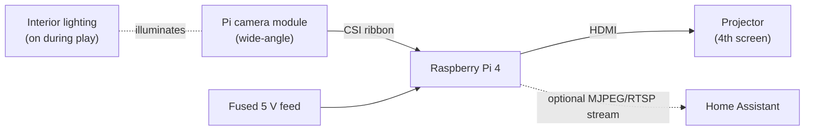

# 08 · Internal Gameplay Camera (planned)

[← Back to README](../README.md)

## Objective

Show a **live view of the real mechanical toys inside the cabinet**, the pop bumpers, slings and flippers, while a table is being played. The feed goes to a **4th screen: a projector**, so spectators and video recordings can see the mechanics firing in sync with the virtual table.

## Options considered

| Option | How it would work | Verdict |
|---|---|---|
| **ESP32-S3-CAM** (GOOUUU N16R8, already owned) | Camera → MJPEG over Wi-Fi → something else must receive and display it | ❌ No HDMI output. A same-model board elsewhere in the house measured about **6 fps** at about 23 KB per frame. Wi-Fi latency is too high to stay in sync with fast coil action |
| **Raspberry Pi + Pi camera** | Camera → Pi GPU → **HDMI straight to the projector** | ✅ **Chosen.** Local pipeline, high frame rate, low latency, no network in the video path |

## Planned design

| Element | Plan | Reasoning |
|---|---|---|
| Computer | Raspberry Pi 4 | Hardware video pipeline and native HDMI |
| Camera | Pi camera module, **wide-angle** (about 120° class) | The toys are close to the lens; a wide field gets bumpers and flippers in one frame |
| Output | Full-screen camera preview to HDMI at boot (e.g. `rpicam-hello -t 0 --fullscreen`) | No desktop, no network: fastest path from sensor to screen |
| Frame rate | 50/60 fps target | Coils fire in tens of milliseconds |
| **Lighting** | Dedicated light that's **on during play** | With the playfield closed the cabinet is dark. The existing interior LED strip is switched by the **coin-door interlock**, so it's off when the door is shut, and it can't be relied on. Options: a small fixed-white strip on its own feed, or a NoIR camera plus IR illuminators (no visible light spill into the cabinet) |
| Mounting | Rigid bracket with rubber isolation | Shaker, knocker and coils cause vibration and blur |
| Power | Pi 4 needs about 5 V 3 A. Either a **dedicated fused branch** from the 5 V rail (short, adequate gauge) or its own USB-C supply from the mains strip | Keep it off ARGB-loaded branches to avoid brown-outs |
| Start/stop | Auto-start the preview on boot; power with the cabinet | Zero interaction during play |
| Integration (optional) | Also expose a low-res stream to HA | Remote viewing or recording; not in the projector path |
| Instrumentation | The 5 V rail clamp (doc 07) will show the Pi's added load | Confirms headroom |

## Open decisions
- Camera module: standard wide vs NoIR with IR illumination.
- Mounting position and angle (bumper cluster vs flipper area, or two cameras later).
- Lighting method and its switching.
- Power source: 5 V rail branch vs separate supply.

## What the existing ESP32-S3-CAM is used for instead
It stays a general-purpose ESPHome camera elsewhere (bird feeder use being considered). It isn't part of the cabinet.
