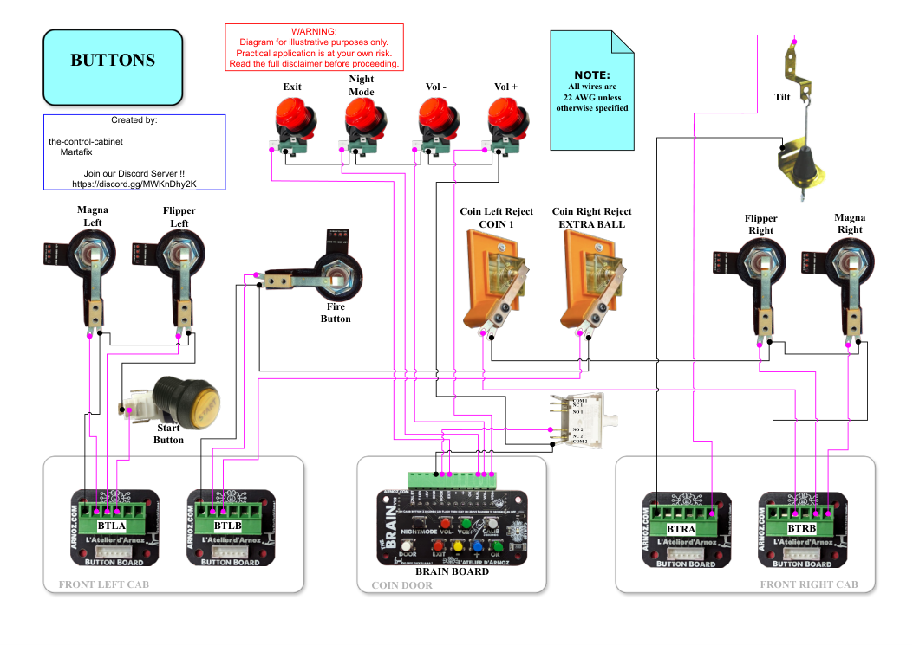
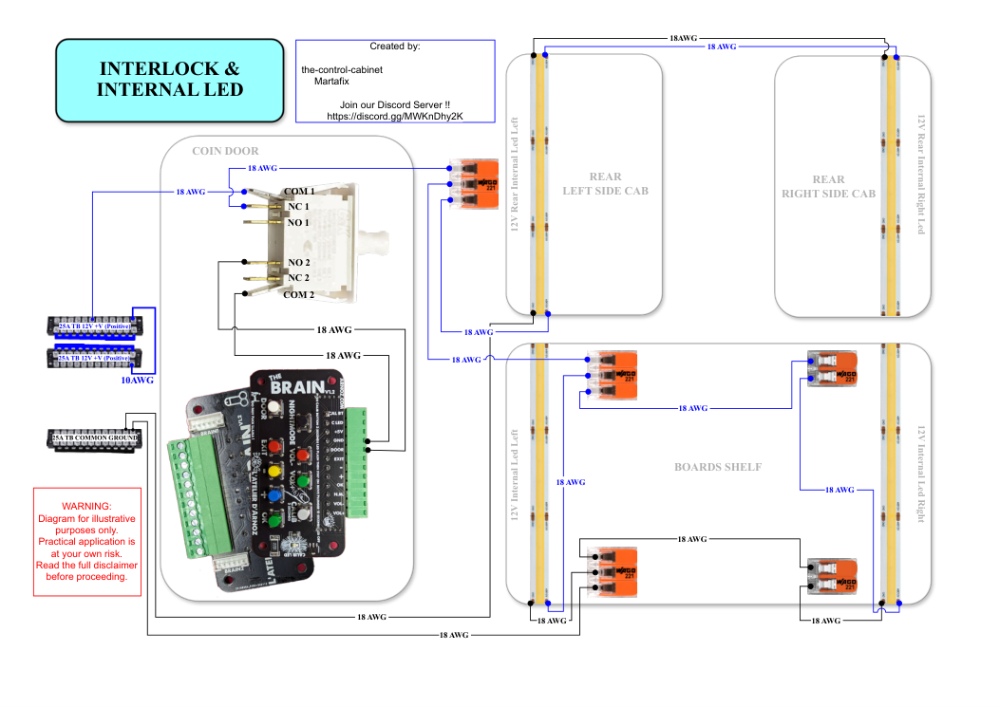
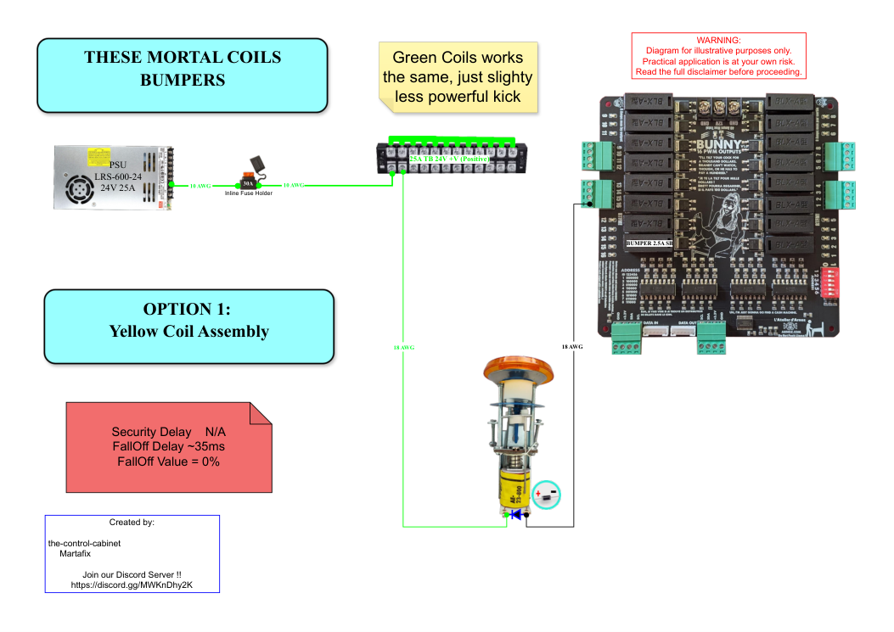
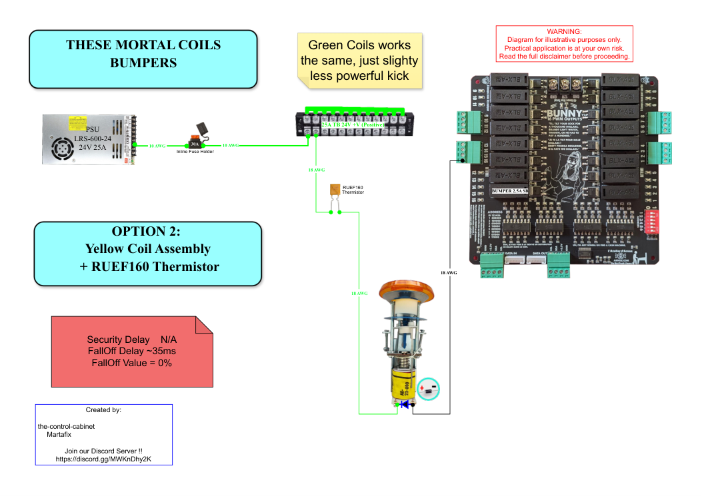
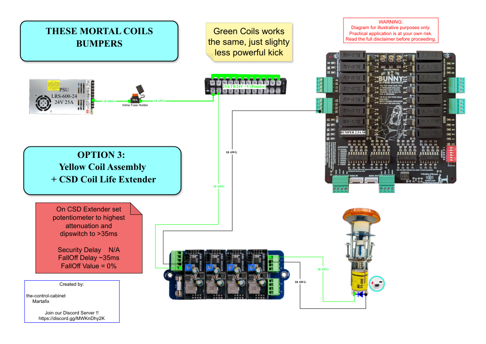
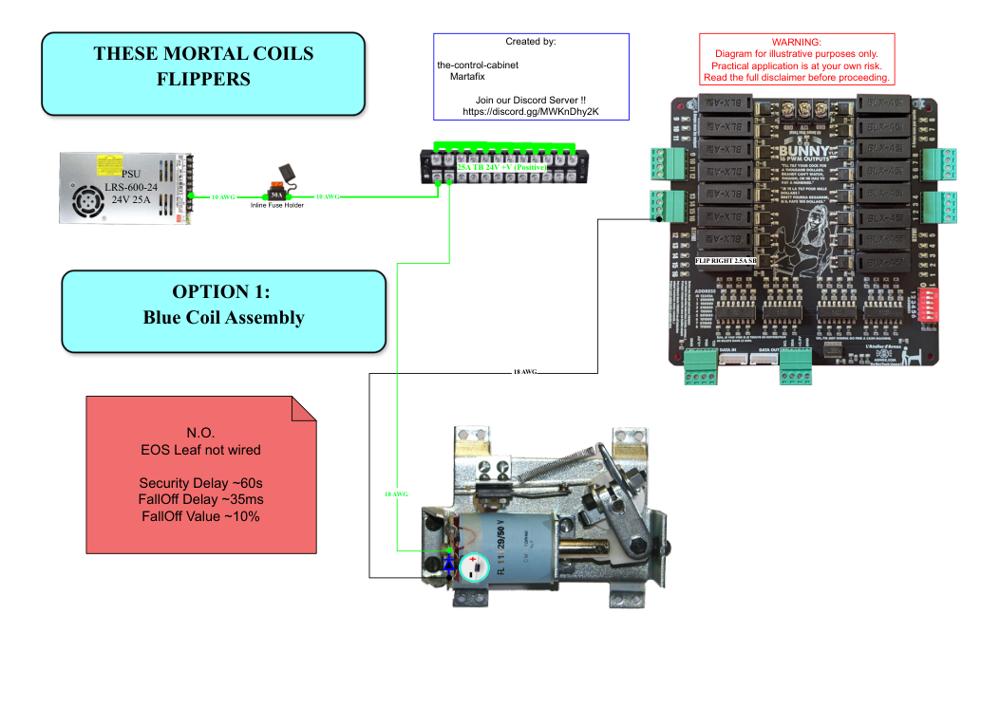
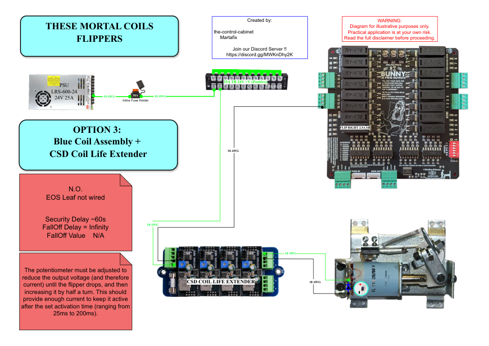
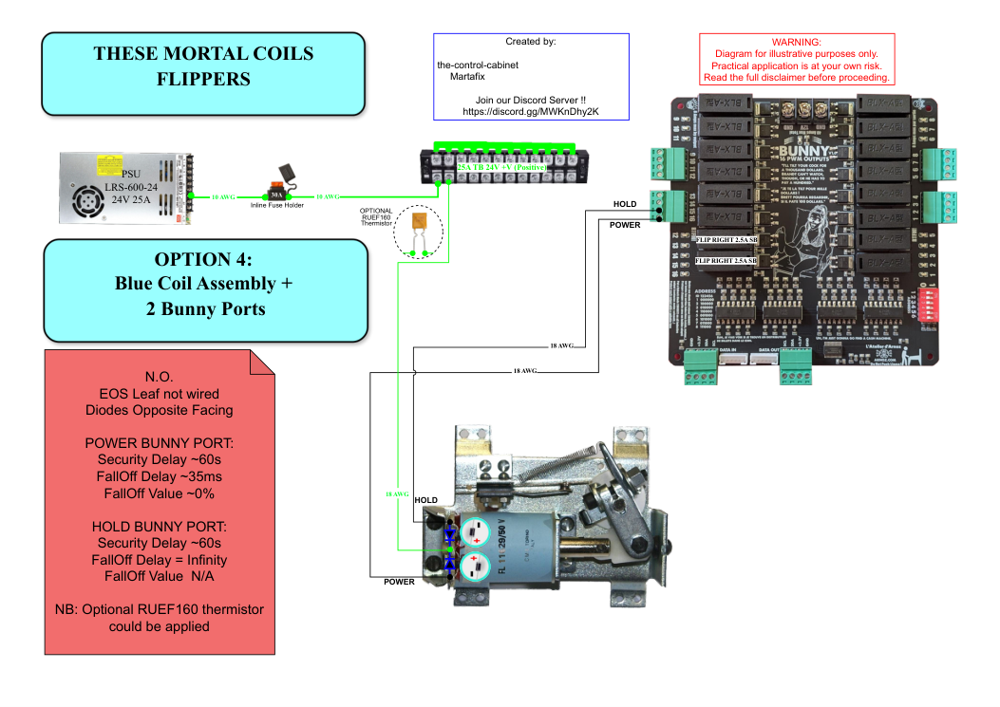
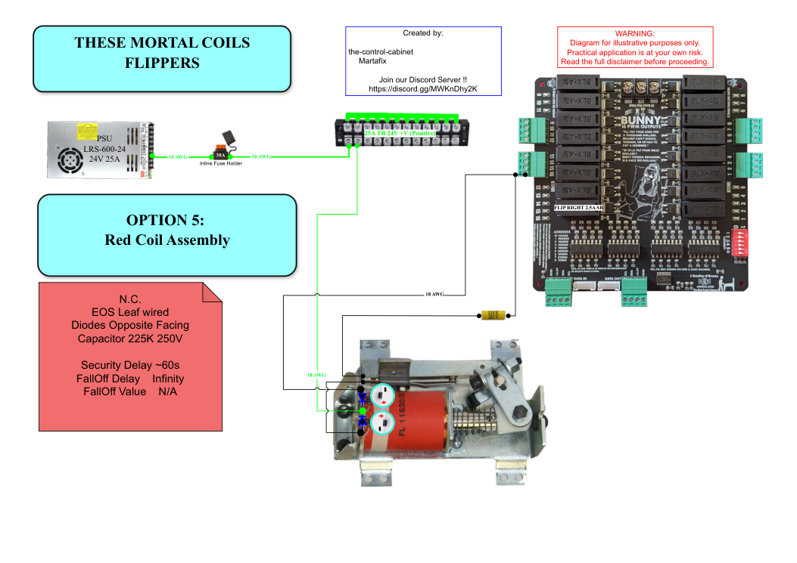
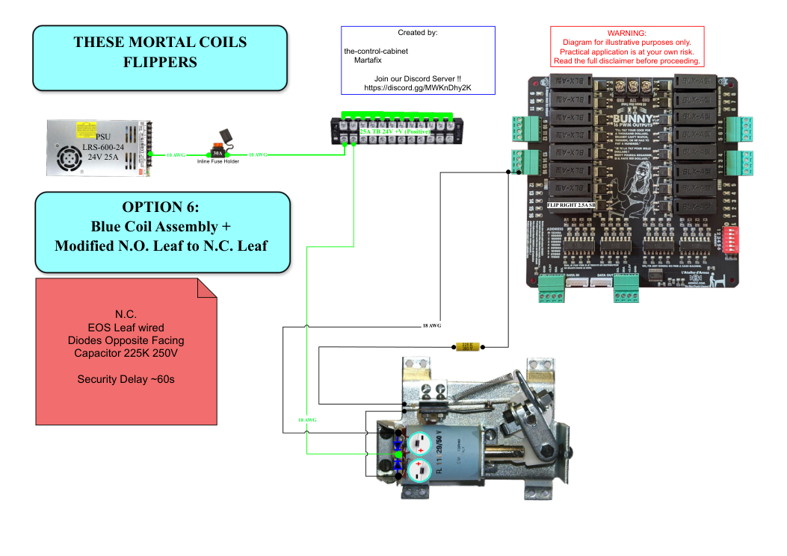

# 12 · Wiring Diagrams

[← Back to README](../README.md)

Original diagrams created by **the-control-cabinet** with **Martafix** (co-author of the *These Mortal Coils* coil-protection series). They are the authoritative as-built record. Click a preview to open the full PDF. Large PDFs may need **Download** or **View raw** on GitHub.

## Cabinet wiring

| Preview | Diagram | What it shows |
|---|---|---|
|  | [12v-24v-toys-single-green-connector-version-v1.5](../diagrams/12v-24v-toys-single-green-connector-version-v1.5.pdf) | Full 12 V / 24 V toy wiring, HD matrix, bumper shelves, coin door, topper, backbox |
|  | [220v-ac-and-pc-connections-v1.1](../diagrams/220v-ac-and-pc-connections-v1.1.pdf) | Mains inlet, power strip, motherboard, USB-C Dude’s Cab, fans, undercab buttons |
|  | [audio-and-ssf-system-v1.2](../diagrams/audio-and-ssf-system-v1.2.pdf) | StarTech 7.1 mapping to three amps, backbox speakers, sub, front/rear SSF |
|  | [boards-interconnections-dudes-cab-plus-mx-donny-version-v1.2](../diagrams/boards-interconnections-dudes-cab-plus-mx-donny-version-v1.2.pdf) | Dude’s Cab + MX Donny + Bunny 1/2 + button boards + Brain + Potar |
|  | [buttons-no-tilt-switch-v1.1](../diagrams/buttons-no-tilt-switch-v1.1.pdf) | Button boards, Brain board, coin/start/fire/magna/flipper wiring |
|  | [dc-power-supply-v1.6](../diagrams/dc-power-supply-v1.6.pdf) | Four Mean Well PSUs, inline fuses, terminal blocks, Bunny 1/2, three Voltboards, MX Donny, amp feeds |
|  | [interlock-and-internal-led-v1.1](../diagrams/interlock-and-internal-led-v1.1.pdf) | Coin door interlock switch, 12 V interior LED strips |

## These Mortal Coils: coil-protection options

Each option shows the coil assembly, Bunny port, fuse, RUEF160 PTC or CSD Coil Life Extender, and the recommended Dude's Cab fall-off and security settings.

| Preview | Option |
|---|---|
|  | [Bumper Sling Option 1 V1.1](../diagrams/this-mortal-coil-bumper-sling-option-1-v1.1.pdf) |
|  | [Bumper Sling Option 2 V1.1](../diagrams/this-mortal-coil-bumper-sling-option-2-v1.1.pdf) |
|  | [Bumper Sling Option 3 V1.2](../diagrams/this-mortal-coil-bumper-sling-option-3-v1.2.pdf) |
|  | [Flipper Option 1 V1.1](../diagrams/this-mortal-coil-flipper-option-1-v1.1.pdf) |
|  | [Flipper Option 2 V1.1](../diagrams/this-mortal-coil-flipper-option-2-v1.1.pdf) |
|  | [Flipper Option 3](../diagrams/this-mortal-coil-flipper-option-3.pdf) |
|  | [Flipper Option 4](../diagrams/this-mortal-coil-flipper-option-4.pdf) |
|  | [Flipper Option 5](../diagrams/this-mortal-coil-flipper-option-5.pdf) |
|  | [Flipper Option 6](../diagrams/this-mortal-coil-flipper-option-6.pdf) |

**As built:** flippers use the power winding only. **+24 V on the right lug, Bunny on the middle**, left lug disconnected, diode band on the right lug. The diagrams show the textbook +24 V-on-middle orientation; either works with the diode band on the +24 V lug. Settings are 10 % fall-off and a ≈60 s security delay, with 2.5 A SB + RUEF160 on all 10 playfield coils. See [04](04-mech-toys-and-coil-protection.md).
