# 12 · Wiring Diagrams

[← Back to README](../README.md)

Original diagrams created by **the-control-cabinet** with **Martafix** (co-author of the *These Mortal Coils* coil-protection series). They are the authoritative as-built record. Click a preview to open the full PDF. Large PDFs may need **Download** or **View raw** on GitHub.

## Cabinet wiring

| Preview | Diagram | What it shows |
|---|---|---|
| [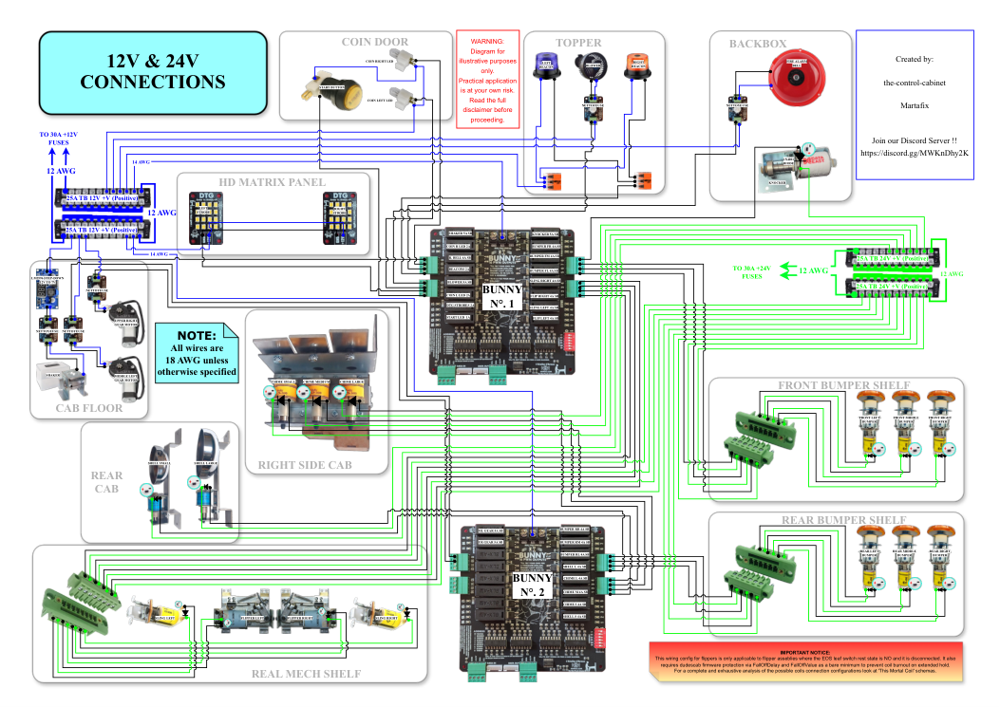](../diagrams/12v-24v-toys-single-green-connector-version-v1.5.pdf) | [12v-24v-toys-single-green-connector-version-v1.5](../diagrams/12v-24v-toys-single-green-connector-version-v1.5.pdf) | Full 12 V / 24 V toy wiring, HD matrix, bumper shelves, coin door, topper, backbox |
| [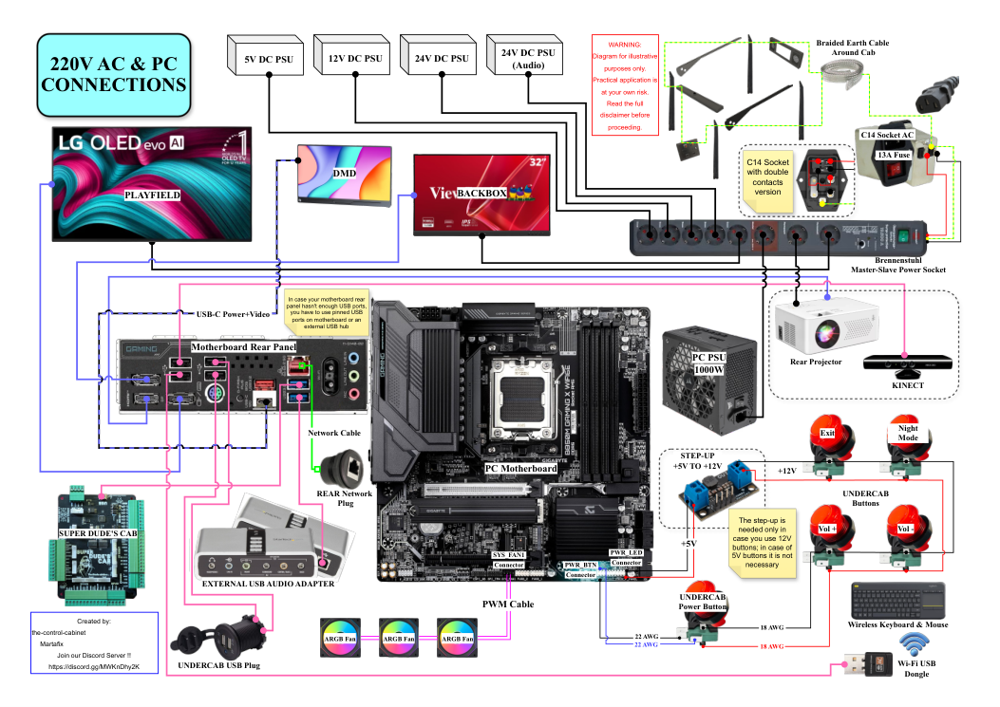](../diagrams/220v-ac-and-pc-connections-v1.1.pdf) | [220v-ac-and-pc-connections-v1.1](../diagrams/220v-ac-and-pc-connections-v1.1.pdf) | Mains inlet, power strip, motherboard, USB-C Dude’s Cab, fans, undercab buttons |
| [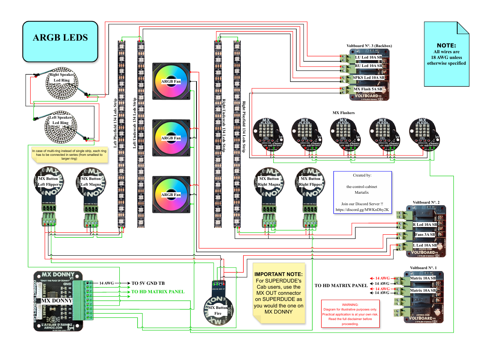](../diagrams/argb-leds.pdf) | [argb-leds](../diagrams/argb-leds.pdf) | 5 V ARGB: MX Donny data outputs and the three Voltboards (fuse per output): HD matrix feeds (2 × 10 A SB, 14 AWG), left/right playfield and undercab strips (134 LEDs each), three ARGB fans (3 A SB), MX flashers (5 A SB), speaker LED rings, MX buttons (flippers, MagnaSaves, Fire). 18 AWG unless marked; SUPERDUDE note |
| [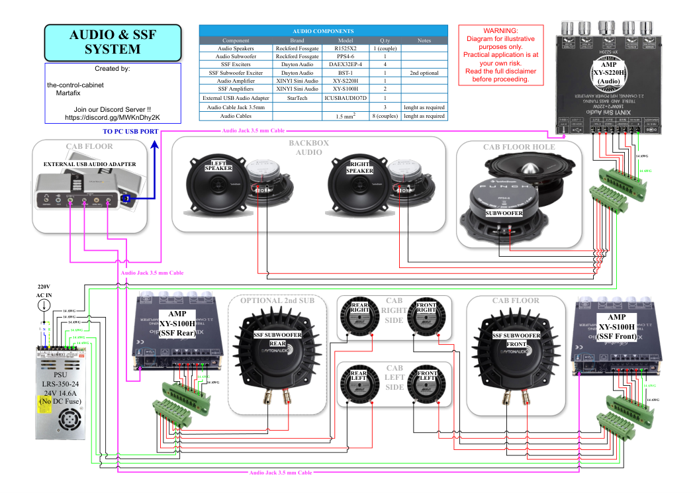](../diagrams/audio-and-ssf-system-v1.2.pdf) | [audio-and-ssf-system-v1.2](../diagrams/audio-and-ssf-system-v1.2.pdf) | StarTech 7.1 mapping to three amps, backbox speakers, sub, front/rear SSF |
| [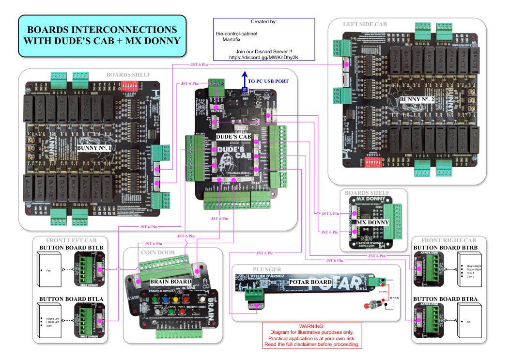](../diagrams/boards-interconnections-dudes-cab-plus-mx-donny-version-v1.2.pdf) | [boards-interconnections-dudes-cab-plus-mx-donny-version-v1.2](../diagrams/boards-interconnections-dudes-cab-plus-mx-donny-version-v1.2.pdf) | Dude’s Cab + MX Donny + Bunny 1/2 + button boards + Brain + Potar |
| [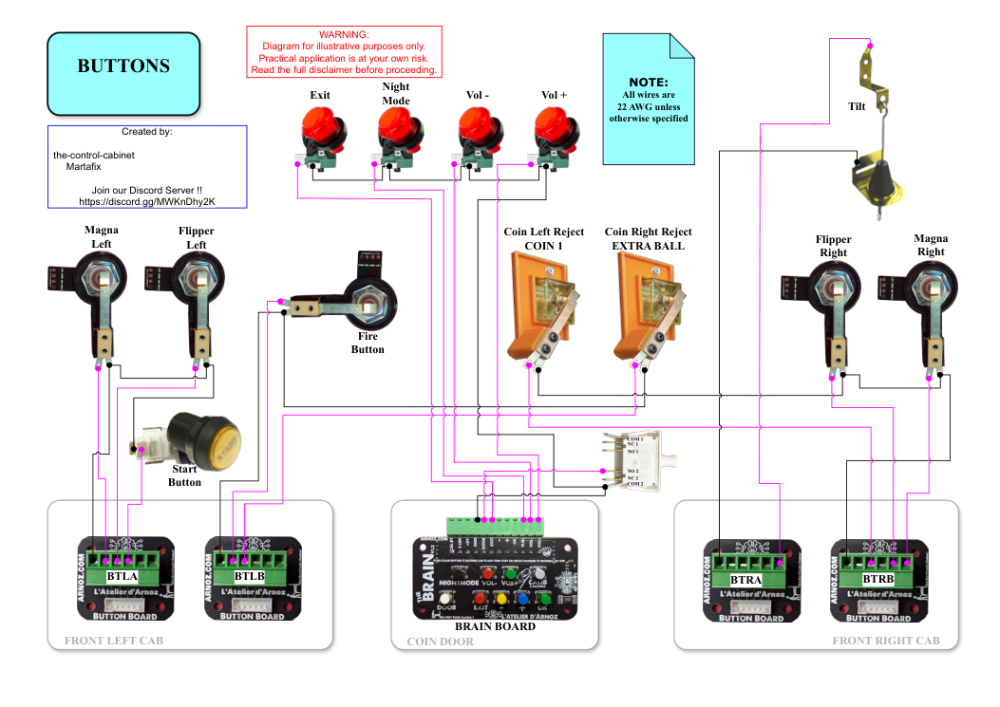](../diagrams/buttons-no-tilt-switch-v1.1.pdf) | [buttons-no-tilt-switch-v1.1](../diagrams/buttons-no-tilt-switch-v1.1.pdf) | Button boards, Brain board, coin/start/fire/magna/flipper wiring |
| [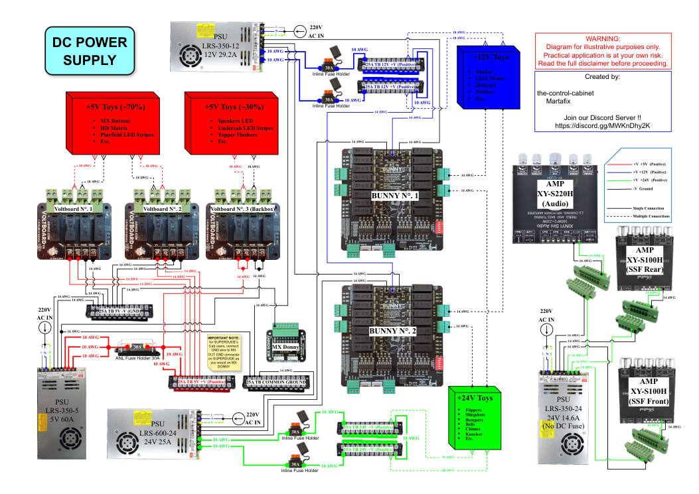](../diagrams/dc-power-supply-v1.6.pdf) | [dc-power-supply-v1.6](../diagrams/dc-power-supply-v1.6.pdf) | Four Mean Well PSUs, inline fuses, terminal blocks, Bunny 1/2, three Voltboards, MX Donny, amp feeds |
| [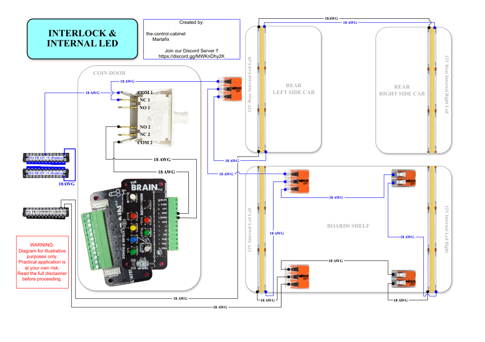](../diagrams/interlock-and-internal-led-v1.1.pdf) | [interlock-and-internal-led-v1.1](../diagrams/interlock-and-internal-led-v1.1.pdf) | Coin door interlock switch, 12 V interior LED strips |

## These Mortal Coils: coil-protection options

Each option shows the coil assembly, Bunny port, fuse, RUEF160 PTC or CSD Coil Life Extender, and the recommended Dude's Cab fall-off and security settings.

| Preview | Option |
|---|---|
| [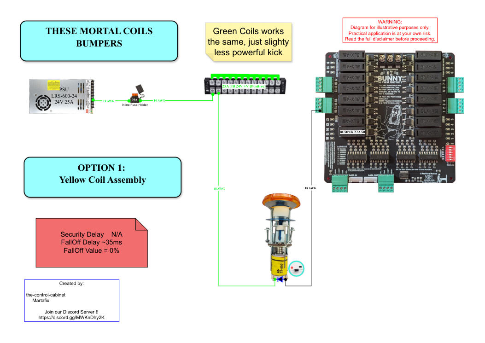](../diagrams/this-mortal-coil-bumper-sling-option-1-v1.1.pdf) | [Bumper Sling Option 1 V1.1](../diagrams/this-mortal-coil-bumper-sling-option-1-v1.1.pdf) |
| [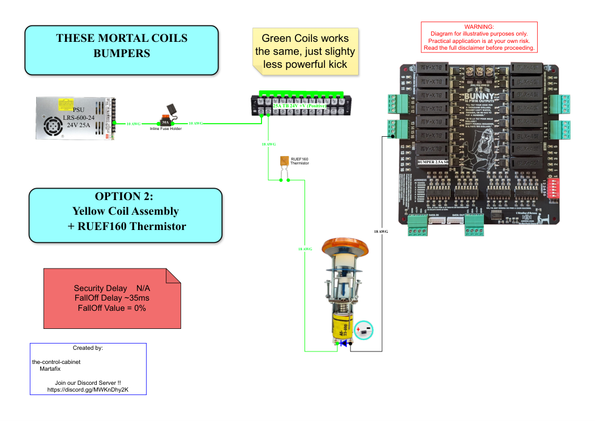](../diagrams/this-mortal-coil-bumper-sling-option-2-v1.1.pdf) | [Bumper Sling Option 2 V1.1](../diagrams/this-mortal-coil-bumper-sling-option-2-v1.1.pdf) |
| [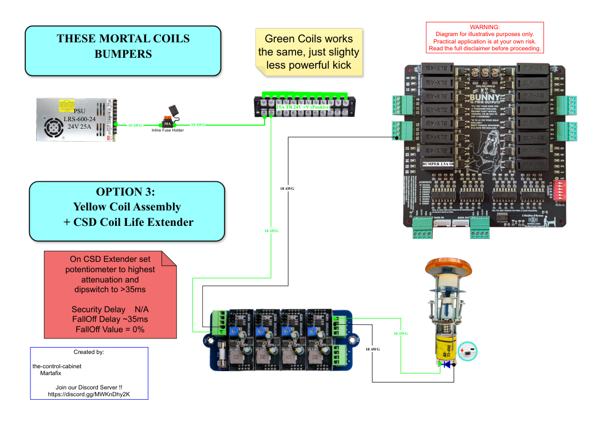](../diagrams/this-mortal-coil-bumper-sling-option-3-v1.2.pdf) | [Bumper Sling Option 3 V1.2](../diagrams/this-mortal-coil-bumper-sling-option-3-v1.2.pdf) |
| [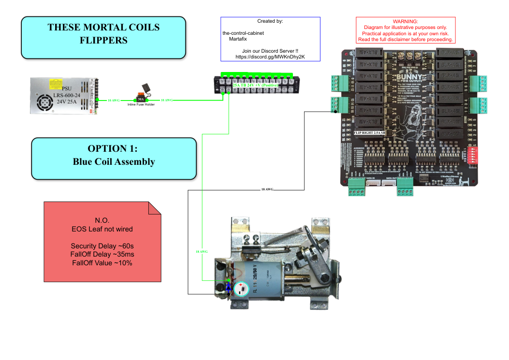](../diagrams/this-mortal-coil-flipper-option-1-v1.1.pdf) | [Flipper Option 1 V1.1](../diagrams/this-mortal-coil-flipper-option-1-v1.1.pdf) |
| [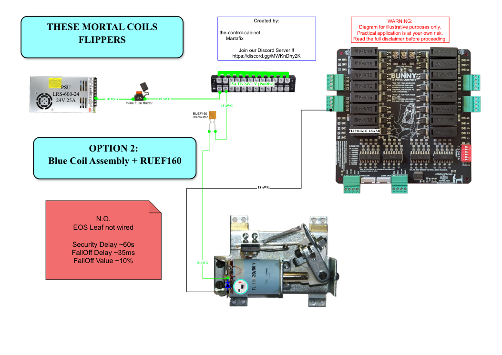](../diagrams/this-mortal-coil-flipper-option-2-v1.1.pdf) | [Flipper Option 2 V1.1](../diagrams/this-mortal-coil-flipper-option-2-v1.1.pdf) |
| [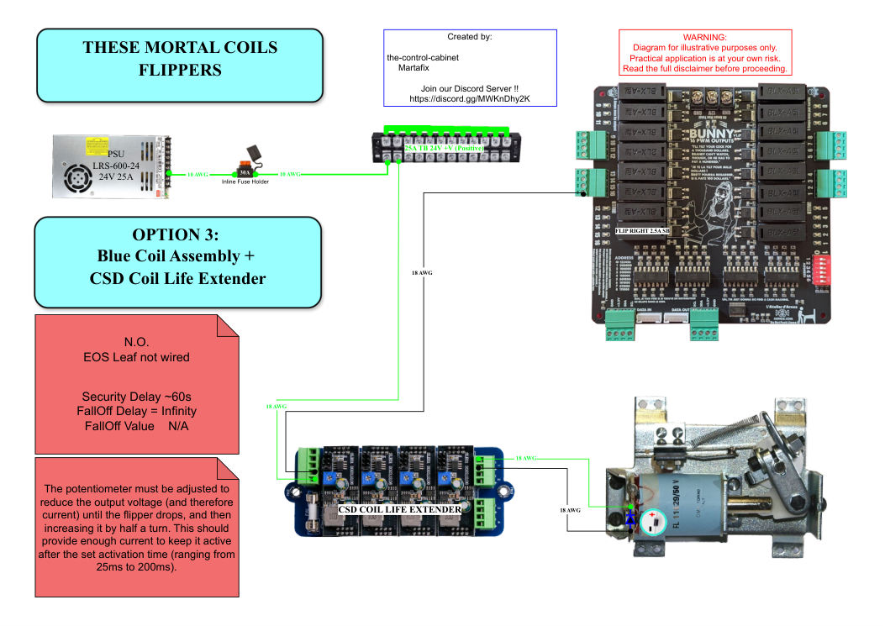](../diagrams/this-mortal-coil-flipper-option-3.pdf) | [Flipper Option 3](../diagrams/this-mortal-coil-flipper-option-3.pdf) |
| [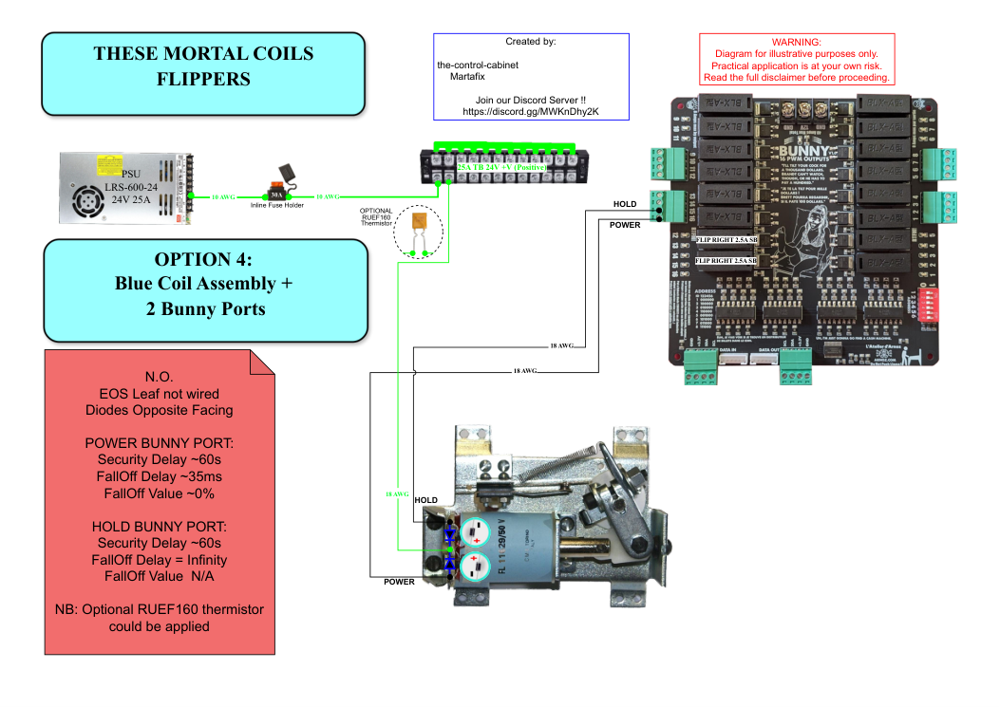](../diagrams/this-mortal-coil-flipper-option-4.pdf) | [Flipper Option 4](../diagrams/this-mortal-coil-flipper-option-4.pdf) |
| [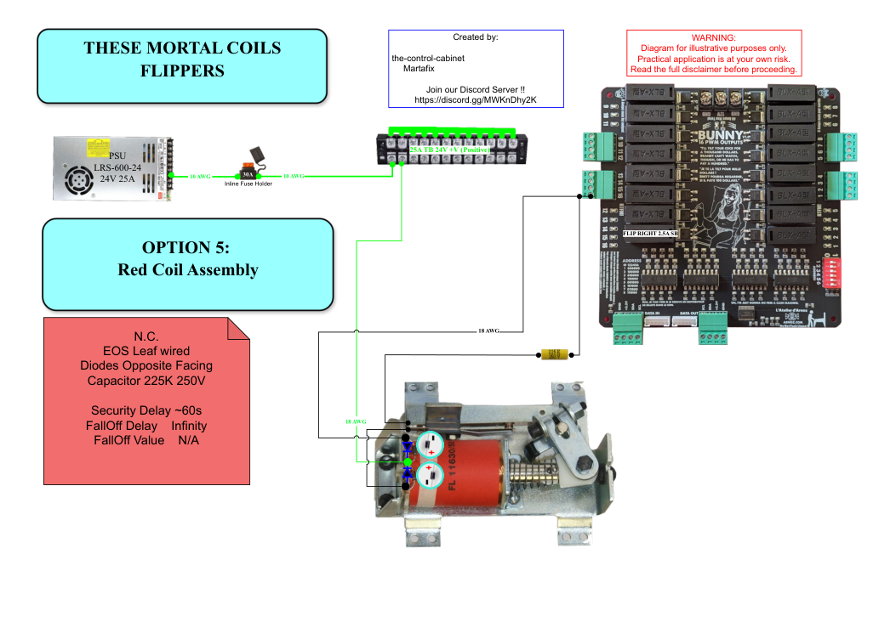](../diagrams/this-mortal-coil-flipper-option-5.pdf) | [Flipper Option 5](../diagrams/this-mortal-coil-flipper-option-5.pdf) |
| [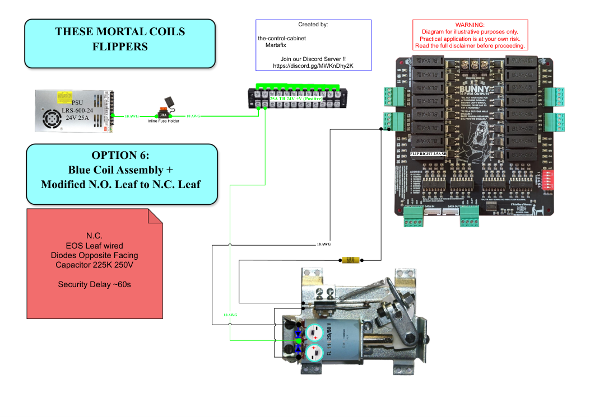](../diagrams/this-mortal-coil-flipper-option-6.pdf) | [Flipper Option 6](../diagrams/this-mortal-coil-flipper-option-6.pdf) |

**As built:** flippers use the power winding only. **+24 V on the right lug, Bunny on the middle**, left lug disconnected, diode band on the right lug. The diagrams show the textbook +24 V-on-middle orientation; either works with the diode band on the +24 V lug. Settings are 10 % fall-off and a ≈60 s security delay, with 2.5 A SB + RUEF160 on all 10 playfield coils. See [04](04-mech-toys-and-coil-protection.md).

## Interior layout drawings, Rev A (26 Nov 2026)

**Tukkari Widebody VPIN – Arnoz Boards – Real-Mech Add-On Pack – Interior Layout Drawings.** Eight sheets drawn from my gridded hand sketches: where every board, PSU, mech, amp, fan and structural part sits inside the cabinet and backbox, each with a code and a key, colour-coded by category. **Not to scale** (relative positions, sizes and alignment follow the sketches).

- **PDF (all eight sheets):** [interior-layout-drawings-rev-a.pdf](../diagrams/interior-layout-rev-a/interior-layout-drawings-rev-a.pdf)
- **Source:** [static HTML](../diagrams/interior-layout-rev-a/source/interior-layout-drawings-rev-a.html) (open in a browser; print to PDF)

| Preview | Sheet | What it shows |
|---|---|---|
| [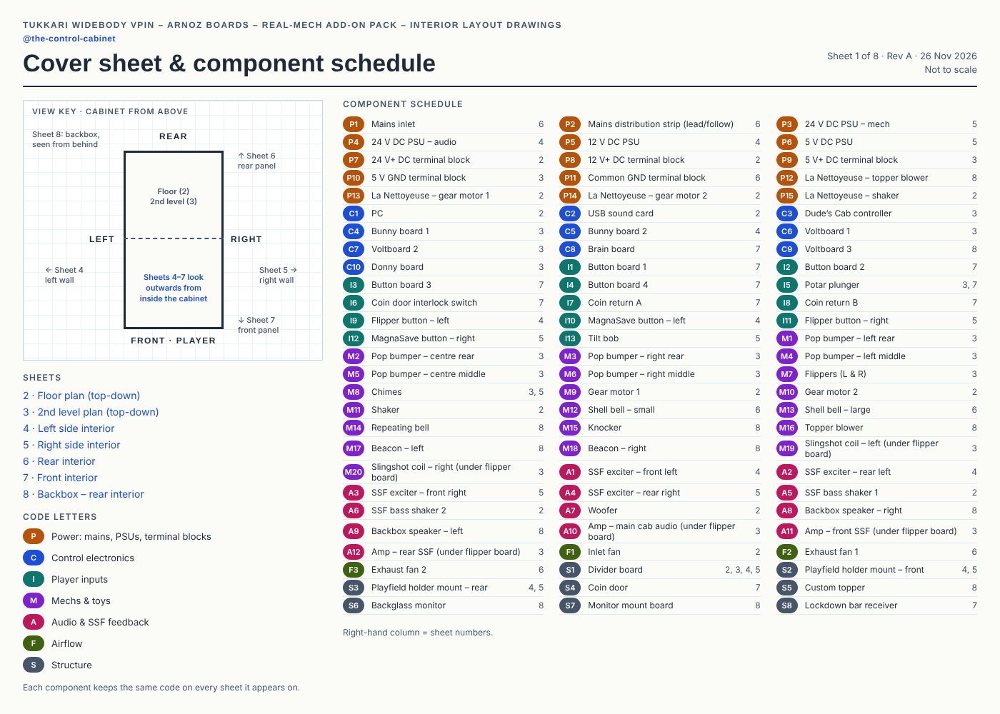](../diagrams/interior-layout-rev-a/01-cover-schedule.png) | Cover and component schedule | Every component code (P power, C control, I inputs, M mechs and toys, A audio, F airflow, S structure) with the sheets it appears on |
| [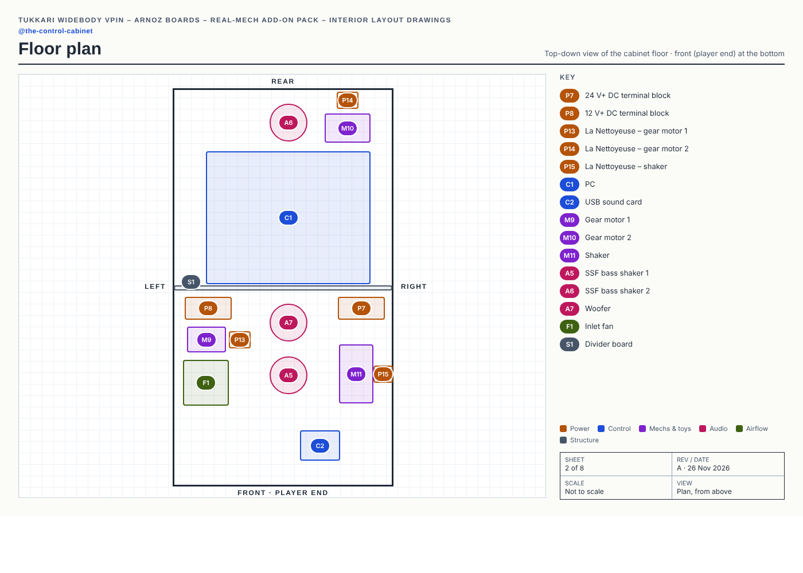](../diagrams/interior-layout-rev-a/02-floor-plan.png) | Floor plan | Cabinet floor from above: PC, USB sound card, gear motors 1 and 2, shaker and their La Nettoyeuse units, bass shakers, woofer, inlet fan, 24 V and 12 V terminal blocks |
| [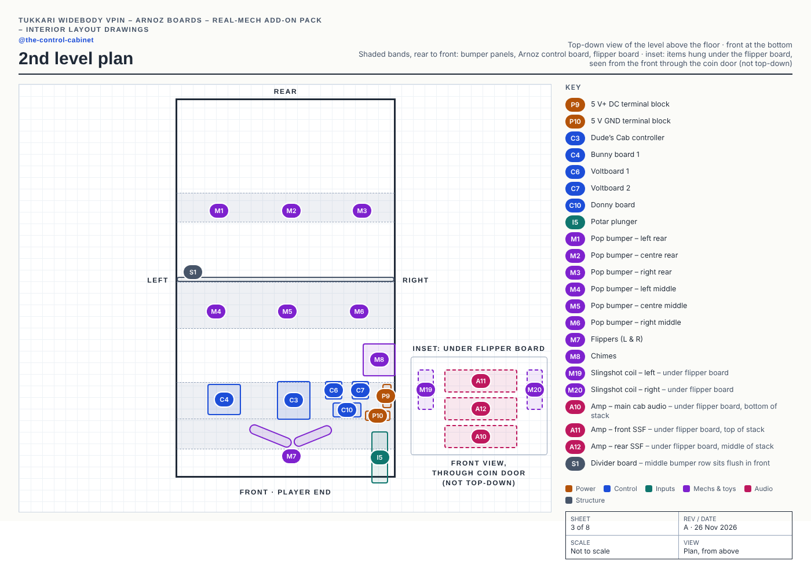](../diagrams/interior-layout-rev-a/03-level-2-plan.png) | Level 2 plan + under-flipper-board inset | The 2nd level: six pop bumpers, chimes, flippers, Dude's Cab, Bunny board 1, Voltboards 1-2, Donny board, 5 V terminal blocks; the inset looks through the coin door (front to back, not top down) at the three amps stacked under the flipper board and the slingshot coils hung either side |
| [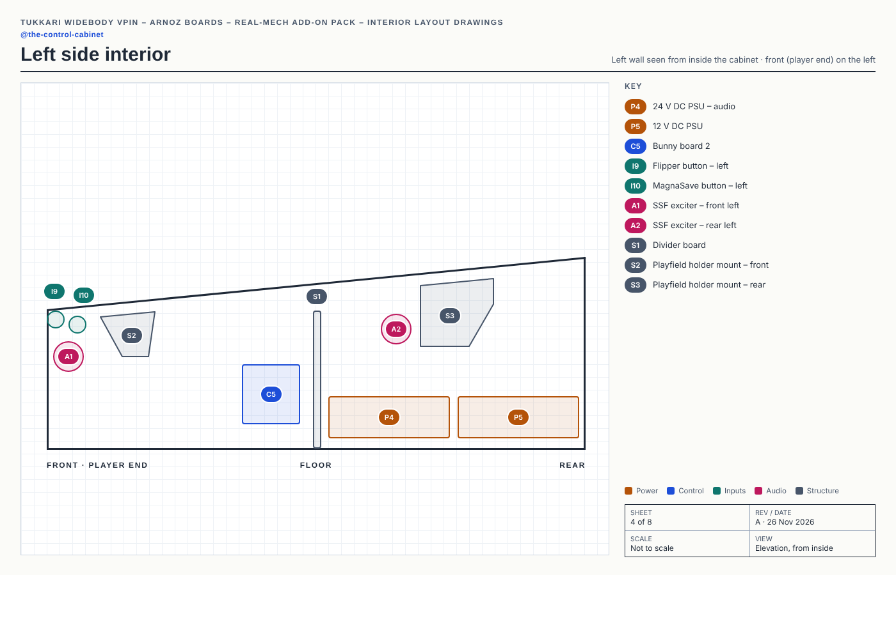](../diagrams/interior-layout-rev-a/04-left-side-interior.png) | Left side interior | Left wall from inside: buttons, front/rear left exciters, playfield holder mounts, Bunny board 2, audio and 12 V PSUs |
| [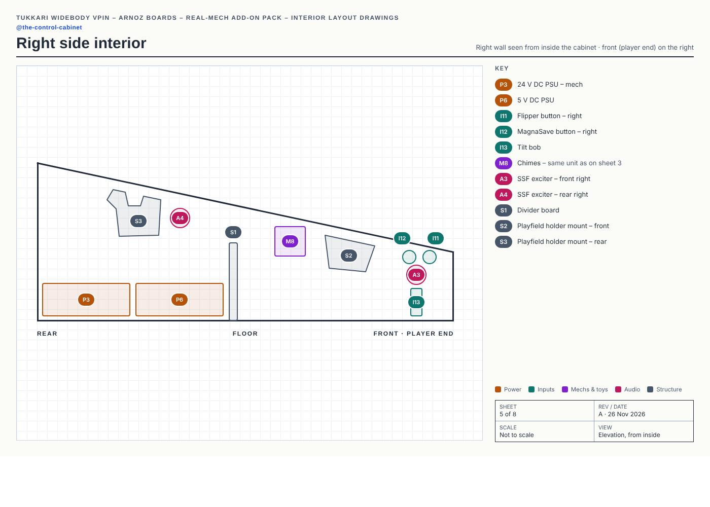](../diagrams/interior-layout-rev-a/05-right-side-interior.png) | Right side interior | Right wall from inside: buttons, exciters, tilt bob, chimes, mech and 5 V PSUs |
| [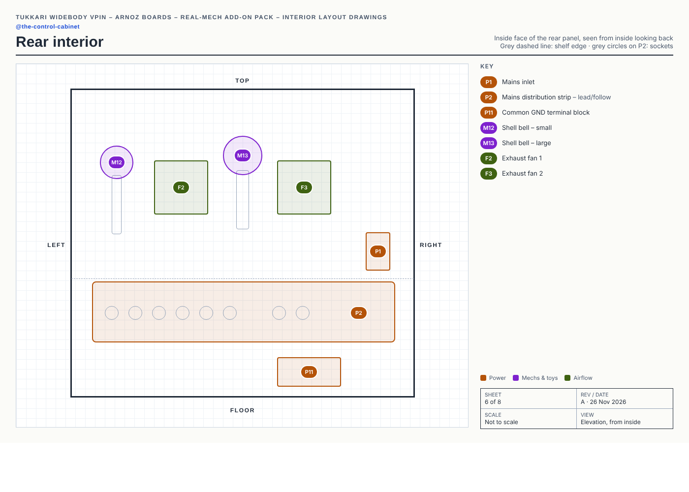](../diagrams/interior-layout-rev-a/06-rear-interior.png) | Rear interior | Rear wall from inside: mains inlet and distribution strip, common GND block, exhaust fans, small and large shell bells |
| [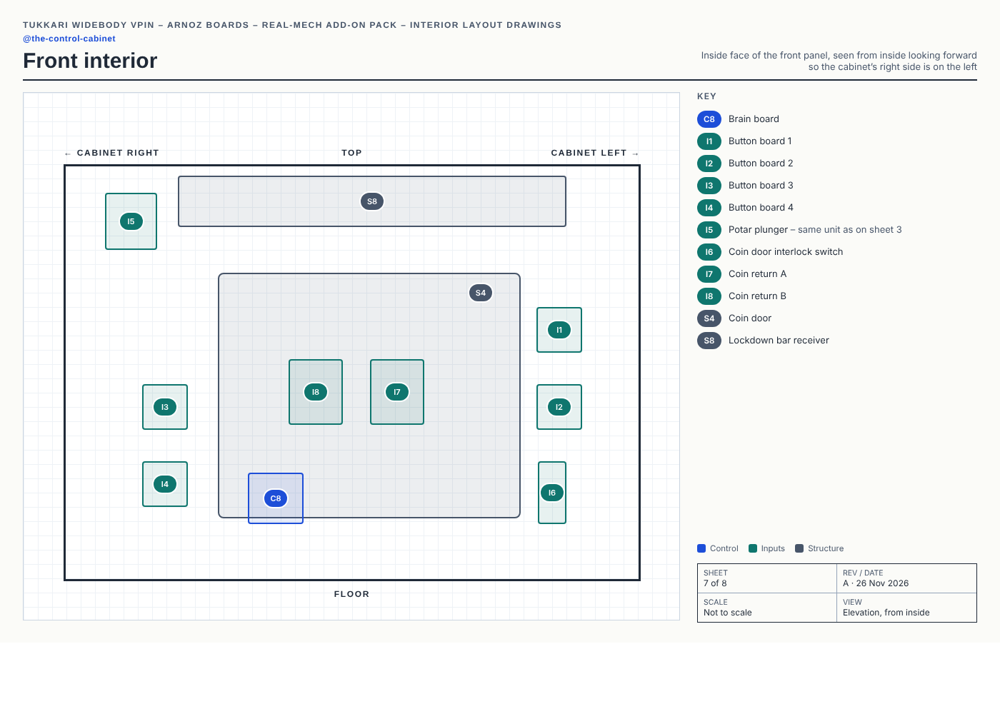](../diagrams/interior-layout-rev-a/07-front-interior.png) | Front interior | Front wall from inside: coin door and interlock switch, coin returns, button boards 1-4, Brain board, Potar plunger, lockdown bar receiver |
| [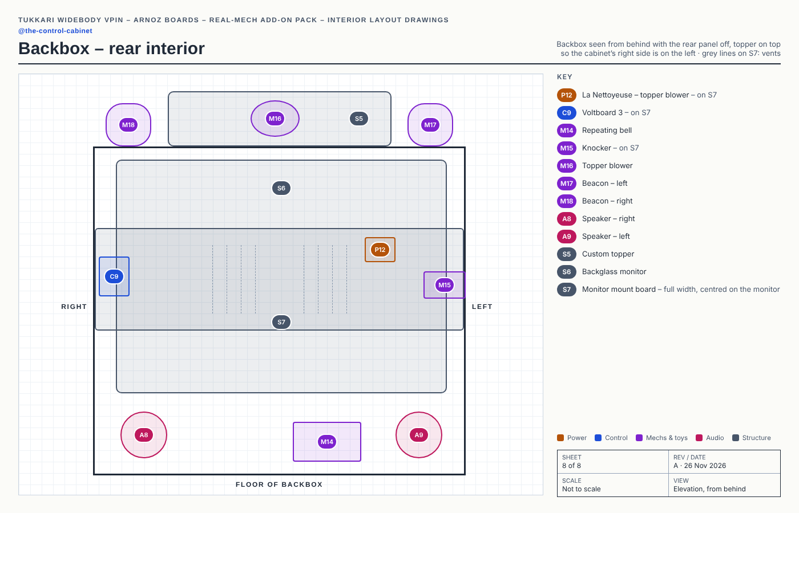](../diagrams/interior-layout-rev-a/08-backbox-rear-interior.png) | Backbox rear interior | Backbox from behind, rear panel off: topper, beacons, blower, monitor and mount board, Voltboard 3, knocker, speakers, repeating bell |

**Stage 2 (planned):** a **3rd level** sheet (the playfield and its ARGB strips), an **under-cab** sheet (the under-cab strips), and a **wiring-routing set** of the same views showing cable routes, wire gauge and colour by circuit type (mains, 24 V, 12 V, 5 V, data, audio).
